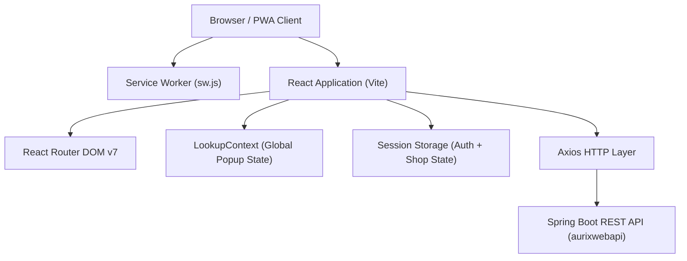
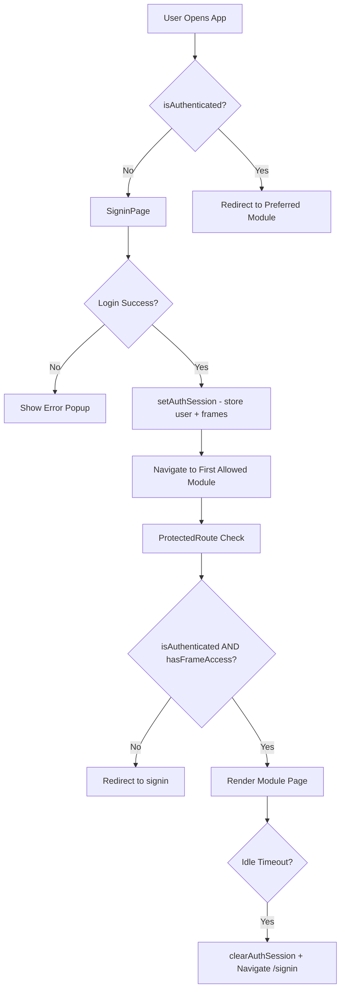
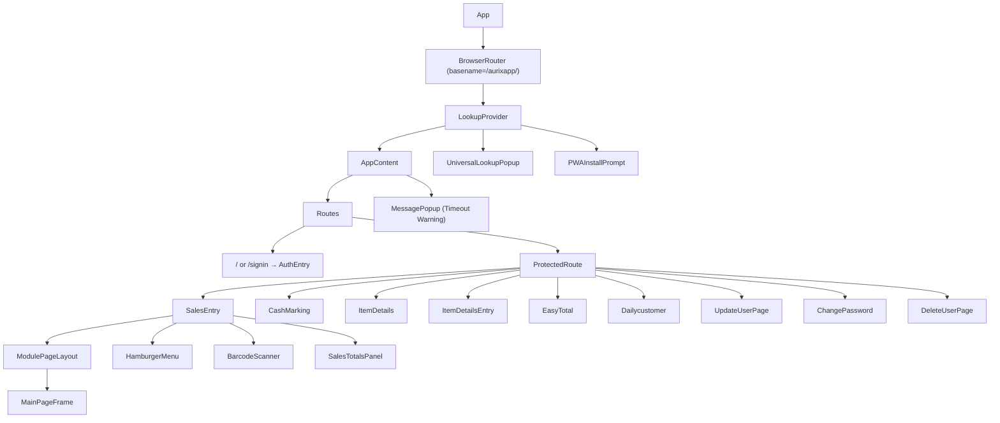
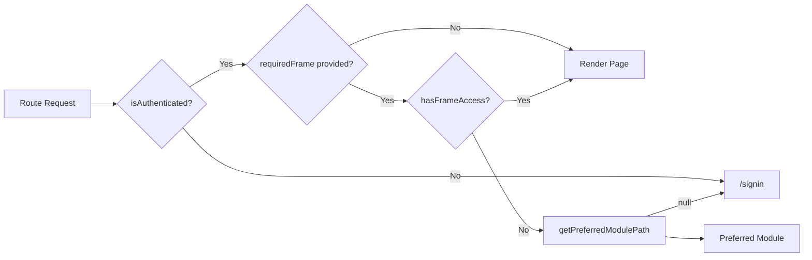
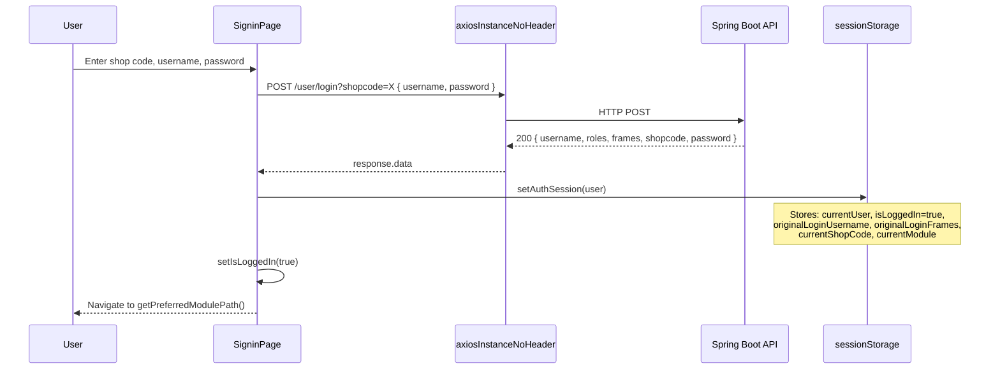
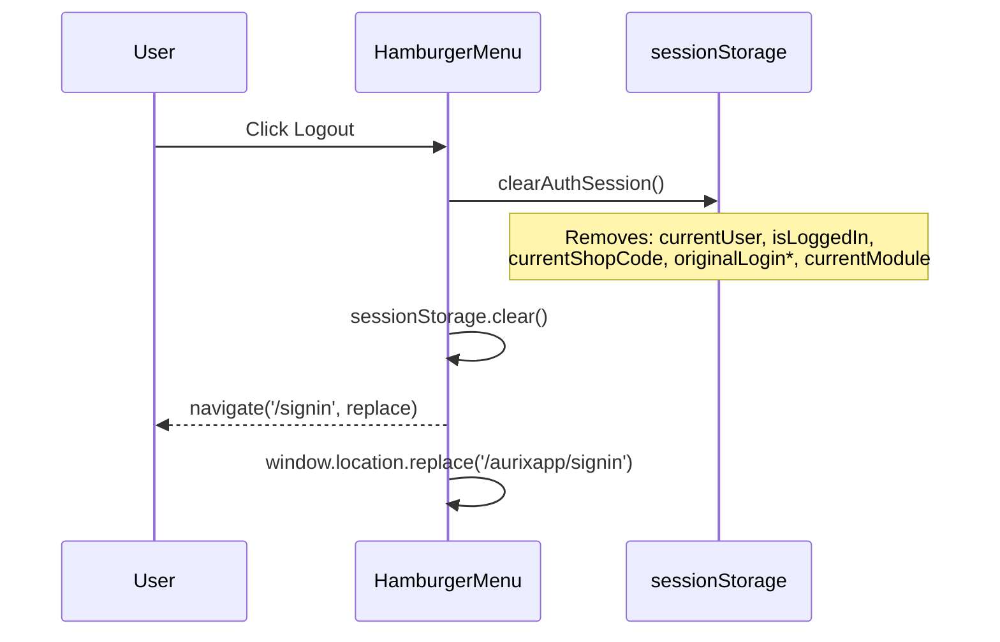
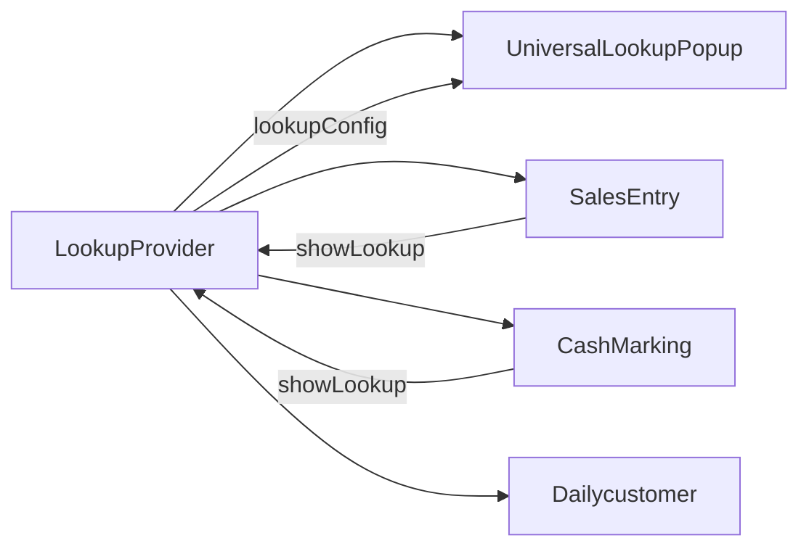

# Aurix Web — Enterprise Frontend Documentation

**Company:** Blogtec Software LLP  
**Project:** Aurix Web (`aurixweb`)  
**Version:** 1.0.13  
**Date:** June 2026  
**Prepared by:** Senior React Architect / Documentation Team

---

## Table of Contents

1. [Project Overview](#1-project-overview)
2. [Frontend Architecture](#2-frontend-architecture)
3. [Folder Structure](#3-folder-structure)
4. [Page Documentation](#4-page-documentation)
5. [Component Documentation](#5-component-documentation)
6. [Routing Documentation](#6-routing-documentation)
7. [API Integration](#7-api-integration)
8. [Authentication & Session Management](#8-authentication--session-management)
9. [State Management](#9-state-management)
10. [Forms and Validation](#10-forms-and-validation)
11. [UI Components Reference](#11-ui-components-reference)
12. [Custom Hooks](#12-custom-hooks)
13. [Utility Functions](#13-utility-functions)
14. [Environment Variables](#14-environment-variables)
15. [Performance Optimization](#15-performance-optimization)
16. [Error Handling](#16-error-handling)
17. [Installation Guide](#17-installation-guide)
18. [Deployment Guide](#18-deployment-guide)
19. [Troubleshooting](#19-troubleshooting)
20. [Coding Standards](#20-coding-standards)
21. [Version History](#21-version-history)
22. [Future Enhancements](#22-future-enhancements)

---

## 1. Project Overview

### Purpose

Aurix Web is an enterprise-grade jewellery shop management Progressive Web Application (PWA) built for **Blogtec Software LLP**. It serves as the frontend interface for a multi-shop jewellery billing and inventory management system, providing real-time sales entry, stock management, customer tracking, and financial reporting capabilities.

### Business Objectives

- Streamline jewellery sales workflows across multiple shop locations
- Provide a unified, mobile-first PWA that works offline and can be installed on any device
- Enable precise gold, silver, and diamond billing with automatic weight and VA% calculations
- Deliver real-time daily customer tracking and salesman-wise reporting
- Ensure role-based access control so each user only sees modules they are authorised to use
- Support multi-currency and multi-country configurations for international deployment

### Features

| Feature | Description |
|---|---|
| **Sales Entry** | Full gold/silver/diamond billing with stone details, barcode scanning, PDF print |
| **Cash Marking** | Post-sale adjustment of VA%, diamond rates, and stone charges |
| **Item Details** | Browse and manage the item/product master |
| **Item Details Entry** | Add/edit/delete item entries with barcode lookup |
| **Easy Total** | Quick daily totals dashboard for shop-wise summary |
| **Daily Customer** | Record and report daily walk-in customers by salesman |
| **Advance / Credit Sales / Purchase** | Sub-modules within Sales Entry for transaction types |
| **User Management** | Register, update, delete, and change passwords for shop users |
| **Barcode Scanner** | Camera-based QR/barcode scanning via `html5-qrcode` |
| **Currency / Region** | Select currency and country with phone validation per locale |
| **PWA Install** | Installable on mobile/desktop with fullscreen support |
| **Auto Logout** | Configurable idle-timeout with server-driven value |
| **Dark Mode** | System-aware + manual dark/light theme toggle |
| **Multi-Shop Switching** | Seamlessly switch between shop codes without full re-login |

### Technology Stack

| Layer | Technology | Version |
|---|---|---|
| Framework | React | 19.1.1 |
| Language | JSX + TypeScript | TypeScript 6.0.3 |
| Build Tool | Vite | 7.1.2 |
| Package Manager | npm | — |
| Styling | Tailwind CSS v4 | 4.0.0 |
| HTTP Client | Axios | 1.12.2 |
| Routing | React Router DOM | 7.9.1 |
| Icons | Font Awesome + Lucide React | FA 7.0.1 / Lucide 1.8.0 |
| PDF Generation | jsPDF + jspdf-autotable | 4.2.1 / 5.0.7 |
| Barcode Scanning | html5-qrcode | 2.3.8 |
| Testing (Unit) | Vitest | 4.1.9 |
| Testing (E2E) | Playwright | 1.61.0 |
| Archive (WAR) | bestzip | 2.2.3 |

### Target Users

| Role | Access |
|---|---|
| **Shop Operator (USER)** | Modules assigned by admin: Sales Entry, Easy Total, etc. |
| **Shop Manager (ADMIN)** | All modules + user update; cannot delete users |
| **Super Admin (SUPERADMIN)** | All modules + user creation/deletion + admin settings |
| **Salesman** | Daily customer entry and reporting only |

---

## 2. Frontend Architecture

### High-Level Architecture



### Application Flow



### Component Hierarchy



### Layout Structure

Every protected module page uses the shared `ModulePageLayout` wrapper:

```
MainPageFrame (glassmorphism container)
└── ModulePageLayout
    ├── Sticky Glass Header (hamburger/back button + page title)
    ├── Page Content (animate-fade-in-up)
    └── HamburgerMenu (slide-in drawer)
```

---

## 3. Folder Structure

```
aurixweb/
├── .env                         # Environment variables (API host/port/project)
├── index.html                   # Vite HTML entry – mounts <div id="root">
├── vite.config.js               # Vite configuration, proxy, build output
├── tailwind.config.js           # Tailwind CSS v4 configuration
├── postcss.config.js            # PostCSS plugins
├── tsconfig.json                # TypeScript compiler options
├── eslint.config.js             # ESLint flat config
├── playwright.config.ts         # Playwright E2E test config
├── package.json                 # Dependencies and npm scripts
├── scripts/
│   └── increment-version.js     # Auto-increments package.json version on build
├── public/
│   ├── blogtec.png              # Company logo (used in SigninPage & Navbar)
│   └── sw.js                   # Service Worker for PWA offline caching
├── src/
│   ├── main.jsx                 # React root mount + Service Worker registration
│   ├── App.jsx                  # Root component: router, idle-timeout, dark mode, PWA fullscreen
│   ├── App.css                  # App-level CSS (minimal overrides)
│   ├── index.css                # Global Tailwind directives + custom CSS utilities
│   ├── SalesRow.ts              # (deprecated at root) – moved to src/models/
│   ├── config/
│   │   └── version.js           # Re-exports APP_VERSION from package.json
│   ├── models/
│   │   └── SalesRow.ts          # TypeScript interfaces: SalesRow, StoneRow, HeaderData
│   ├── services/                # Axios-based API service modules
│   │   ├── axiosConfig.js       # Two Axios instances: authenticated + no-header
│   │   ├── BarcodeAPI.js        # Barcode data, images (server + local)
│   │   ├── CashMarkingAPI.js    # Cash marking CRUD
│   │   ├── CompanyAPI.js        # Company details and images
│   │   ├── DailyCustomerApi.js  # Daily customer CRUD + reports
│   │   ├── DiscountDetailsAPI.js# Discount records, idle timeout setting
│   │   ├── DynamicQueryApi.js   # Generic secure dynamic SQL query executor
│   │   ├── easyTotalApi.js      # Easy total data fetch
│   │   ├── JewellersPage.js     # (placeholder / legacy)
│   │   ├── MetadataAPI.js       # Currencies + default country metadata
│   │   ├── SalesEntryApi.js     # Main sales CRUD, stones, salesmen, barcodes, print
│   │   └── ShopAPI.js           # Shop codes, CRM customers, user existence check
│   ├── context/                 # (Empty – Context is co-located in common/)
│   ├── utils/
│   │   ├── format.ts            # Numeric getters + string formatters for wt/amt/qty
│   │   ├── session.js           # All sessionStorage auth/shop/currency helpers
│   │   ├── shopSwitch.js        # Multi-shop switch logic with re-auth
│   │   ├── SharedBillingCalculator.ts # Pure billing calculations (sales/credit/purchase)
│   │   ├── SharedBillingCalculator.test.ts # Vitest unit tests for calculator
│   │   ├── playwright.config.ts # (Duplicate – E2E config for utils spec)
│   │   └── signin.spec.ts       # Playwright E2E sign-in test
│   └── components/
│       ├── common/              # Reusable cross-module UI components
│       │   ├── BarcodeScanner.jsx       # Camera QR/barcode scanner modal
│       │   ├── CurrencySelector.jsx     # Country/currency picker dropdown
│       │   ├── LookupContext.jsx        # Global lookup popup context + predefined configs
│       │   ├── MessagePopup.jsx         # Accessible toast/modal for messages
│       │   ├── ModernConfirmModal.jsx   # Yes/No destructive confirmation dialog
│       │   ├── PWAInstallPrompt.jsx     # PWA install banner
│       │   └── UniversalLookupPopup.jsx # Shared data-lookup popup driven by LookupContext
│       ├── layout/              # Page wrapper/shell components
│       │   ├── MainPageFrame.jsx        # Outer glassmorphism container
│       │   └── ModulePageLayout.jsx     # Standard header + content + hamburger layout
│       └── pages/               # Route-level page components
│           ├── ChangePassword.jsx
│           ├── Dailycustomer.jsx
│           ├── DeleteUserPage.jsx
│           ├── EasyTotal.jsx
│           ├── HamBurger.jsx            # Slide-in navigation menu drawer
│           ├── HomePage.jsx             # Public landing page (Navbar, Hero, Features)
│           ├── ItemDetails.jsx          # Item/product master browser
│           ├── ItemDetailsEntry.jsx     # Item add/edit/delete form
│           ├── ItemLookup.jsx           # Standalone item lookup helper
│           ├── ProtectedRoute.jsx       # Auth + frame-access guard HOC
│           ├── RegisterPage.jsx         # New user registration form
│           ├── SigninPage.jsx           # Login page (animated panels)
│           ├── UpdateUserFrames.jsx     # Edit user's module-frame permissions
│           ├── UpdateUserPage.jsx       # User update router/shell
│           └── sales/
│               ├── Advance.jsx          # Advance payment entry (sub-module)
│               ├── CashMarking.jsx      # Cash marking / rate adjustment
│               ├── CreditSales.jsx      # Credit note entry
│               ├── Purchase.jsx         # Purchase entry sub-module
│               ├── SalesEntry.tsx       # Primary sales billing module (largest file)
│               └── SalesTotalsPanel.jsx # Grand total summary panel
```

---

## 4. Page Documentation

### 4.1 Sign-In Page

| Property | Value |
|---|---|
| **Route** | `/` or `/signin` |
| **File** | `src/components/pages/SigninPage.jsx` |
| **Protection** | Public – redirects authenticated users to preferred module |

**Purpose:** Entry point for all users. Presents an animated dual-panel login form.

**UI Description:**
- Animated sliding panels (left: sign-in form, right: sign-up CTA)
- Company name loaded dynamically from API using shop code
- Shop code auto-populated from session or API default
- Version number displayed in footer
- Supports shop-switch pending flow (redirected here for re-auth)

**Components Used:** `MessagePopup`, `CurrencySelector` (inside drawer in Hamburger — not on this page directly)

**Backend APIs Consumed:**

| API | Endpoint | Method |
|---|---|---|
| Get Default Shop Code | `customer/getdefaultshopcode` | GET |
| User Login | `/user/login?shopcode=X` | POST |
| Get Company Details | `company/details?shopcode=X` | GET |

**Navigation Flow:** Success → `getPreferredModulePath()` → first allowed module route

---

### 4.2 Register Page

| Property | Value |
|---|---|
| **Route** | `/register` |
| **File** | `src/components/pages/RegisterPage.jsx` |
| **Protection** | Public |

**Purpose:** Allows creation of new shop user accounts. Admins use this to add new operators.

**Backend APIs Consumed:** `user/register` (POST)

---

### 4.3 Home Page

| Property | Value |
|---|---|
| **Route** | Not directly routed – accessible via `/` before auth |
| **File** | `src/components/pages/HomePage.jsx` |
| **Protection** | Public |

**Purpose:** Public marketing landing page with animated navbar, hero section, features, and contact footer. Uses scroll-hide navbar behaviour.

---

### 4.4 Sales Entry

| Property | Value |
|---|---|
| **Route** | `/salesentry` |
| **File** | `src/components/pages/sales/SalesEntry.tsx` (~277KB, primary module) |
| **Protection** | `requiredFrame="SALES ENTRY"` |

**Purpose:** Core billing module. Handles full jewellery sales transactions for gold and silver, including:
- Header: estimate number, date, gold/silver rate, customer info, GST/IGST
- Sales grid: barcode lookup, item code, weight/stone details, VA%, gold/stone amounts
- Stone Details sub-grid per row
- Salesman assignment
- Advance, Credit Note, and Purchase sub-sections
- Print (PDF/thermal) via `salesprint/report/{estNo}`
- Barcode camera scan integration

**Components Used:** `ModulePageLayout`, `HamburgerMenu`, `BarcodeScanner`, `MessagePopup`, `ModernConfirmModal`, `SalesTotalsPanel`, `UniversalLookupPopup` (via `LookupContext`)

**Backend APIs Consumed:** (See [Section 7.5 — SalesEntryApi](#75-salesentryapi))

---

### 4.5 Cash Marking

| Property | Value |
|---|---|
| **Route** | `/cashmarking` |
| **File** | `src/components/pages/sales/CashMarking.jsx` |
| **Protection** | `requiredFrame="CASH MARKING"` |

**Purpose:** Post-sale adjustment module. Allows authorised users to:
- Look up an estimate by number
- Adjust VA amounts, diamond rates, stone charges, and VA%
- Reset estimate data
- Generate discount reports

**Backend APIs Consumed:** (See [Section 7.2 — CashMarkingAPI](#72-cashmarkingapi))

---

### 4.6 Item Details

| Property | Value |
|---|---|
| **Route** | `/itemdetails` |
| **File** | `src/components/pages/ItemDetails.jsx` |
| **Protection** | `requiredFrame="ITEM DETAILS"` |

**Purpose:** Browse and view the item/product master. Read-only list with filter/search.

---

### 4.7 Item Details Entry

| Property | Value |
|---|---|
| **Route** | `/itemdetailsentry` |
| **File** | `src/components/pages/ItemDetailsEntry.jsx` |
| **Protection** | `requiredFrame="ITEM DETAILS ENTRY"` |

**Purpose:** Create, edit, and delete item records including barcode associations.

---

### 4.8 Easy Total

| Property | Value |
|---|---|
| **Route** | `/easytotal` |
| **File** | `src/components/pages/EasyTotal.jsx` |
| **Protection** | `requiredFrame="EASY TOTAL"` |

**Purpose:** Quick daily totals dashboard. Displays shop-wise aggregated sales summary data.

**Backend APIs Consumed:** `easytotal/geteasytotal?shopcode=X` (GET)

---

### 4.9 Daily Customer

| Property | Value |
|---|---|
| **Route** | `/dailycustomer` |
| **File** | `src/components/pages/Dailycustomer.jsx` |
| **Protection** | `requiredFrame="DAILY VISITING CUSTOMER"` |

**Purpose:** Record daily walk-in customer interactions with salesman assignment, phone capture, and date-wise reporting with PDF export.

**Backend APIs Consumed:** (See [Section 7.3 — DailyCustomerApi](#73-dailycustomerapi))

---

### 4.10 User Management Pages

| Page | Route | File | Description |
|---|---|---|---|
| Update User | `/updateuser` | `UpdateUserPage.jsx` | Shell for user update workflow |
| Update Frames | `/updateframes` | `UpdateUserFrames.jsx` | Edit user's module-frame permissions |
| Change Password | `/changepassword` | `ChangePassword.jsx` | Password change form |
| Delete User | `/deleteuser` | `DeleteUserPage.jsx` | Delete a shop user (admin only) |

---

### 4.11 Sub-Modules (within Sales Entry)

| Page | Route | File | Description |
|---|---|---|---|
| Advance | `/advance` | `sales/Advance.jsx` | Advance payment sub-module |
| Credit Sales | `/creditsales` | `sales/CreditSales.jsx` | Credit note entry |
| Purchase | `/purchase` | `sales/Purchase.jsx` | Purchase billing sub-module |

---

## 5. Component Documentation

### 5.1 `ProtectedRoute`

**File:** `src/components/pages/ProtectedRoute.jsx`  
**Purpose:** Route guard HOC. Checks authentication and optional frame-level access.

| Prop | Type | Description |
|---|---|---|
| `children` | `ReactNode` | The protected page component |
| `routePath` | `string` | The current route path (stored as `currentModule`) |
| `requiredFrame` | `string` (optional) | Frame name the user must have (e.g., `"SALES ENTRY"`) |

**Logic:**
1. On mount, stores `routePath` to `sessionStorage.currentModule`
2. If `!isAuthenticated()` → redirects to `/signin`
3. If `requiredFrame` is provided and `!hasFrameAccess(requiredFrame)` → redirects to first allowed module or `/signin`

```jsx
// Usage
<ProtectedRoute routePath="/salesentry" requiredFrame="SALES ENTRY">
  <SalesEntry />
</ProtectedRoute>
```

---

### 5.2 `MessagePopup`

**File:** `src/components/common/MessagePopup.jsx`  
**Purpose:** Accessible modal/toast for status messages (success, error, info).

| Prop | Type | Default | Description |
|---|---|---|---|
| `open` | `boolean` | — | Controls visibility |
| `title` | `string` | `"Access Message"` | Modal title |
| `message` | `string` | — | Body message text |
| `type` | `'success' \| 'error' \| 'info'` | auto-detected | Controls colour theme |
| `onClose` | `() => void` | — | Callback when closed |
| `actions` | `Array<{label, onClick, variant}>` | `[]` | Custom action buttons |

**Behaviour:**
- Success messages auto-close after 2 seconds with a progress bar
- Error/info messages require manual OK click
- Focus is trapped to the OK button on open
- Rendered via `createPortal` to `document.body`

```jsx
<MessagePopup
  open={!!errorMessage}
  title="Save Failed"
  message={errorMessage}
  type="error"
  onClose={() => setErrorMessage("")}
/>
```

---

### 5.3 `ModernConfirmModal`

**File:** `src/components/common/ModernConfirmModal.jsx`  
**Purpose:** Two-button (Confirm / Cancel) confirmation dialog with optional destructive styling.

| Prop | Type | Default | Description |
|---|---|---|---|
| `isOpen` | `boolean` | — | Visibility |
| `title` | `string` | `"Confirmation"` | Dialog title |
| `message` | `string` | — | Dialog body |
| `onConfirm` | `() => void` | — | Confirm callback |
| `onCancel` | `() => void` | — | Cancel callback |
| `confirmText` | `string` | `"Yes, Proceed"` | Confirm button label |
| `cancelText` | `string` | `"No, Cancel"` | Cancel button label |
| `isDestructive` | `boolean` | `false` | If true, uses rose/red styling |

- `Escape` key triggers cancel
- Clicking backdrop triggers cancel
- Rendered via `createPortal`

---

### 5.4 `BarcodeScanner`

**File:** `src/components/common/BarcodeScanner.jsx`  
**Purpose:** Full-screen camera modal for scanning barcodes and QR codes.

| Prop | Type | Description |
|---|---|---|
| `onScan` | `(decodedText: string) => void` | Called once per scan with decoded value |
| `onClose` | `() => void` | Called when user dismisses scanner |

**Supported Formats:** QR Code, EAN-8/13, UPC-A/E, CODE-39/93/128, Codabar, ITF, DataMatrix, Aztec, PDF-417

**Library:** `html5-qrcode` v2.3.8 (ZXing engine forced for reliable 1D format support)

---

### 5.5 `LookupContext` / `LookupProvider`

**File:** `src/components/common/LookupContext.jsx`  
**Purpose:** React Context for a global, shared data lookup popup. Any component can request a lookup by calling `showLookup(config)`.

**Context Value:**

| Key | Type | Description |
|---|---|---|
| `lookupConfig` | `object` | Current lookup configuration including `isOpen` flag |
| `showLookup` | `(config) => void` | Open the lookup popup with a given config |
| `hideLookup` | `() => void` | Close the lookup popup |

**Custom Hook:** `useLookup()` — must be used inside `<LookupProvider>`.

**Predefined Lookup Configs (in `lookupConfigs`):**

| Key | Title | Data Source |
|---|---|---|
| `estno` | Estimate Lookup (GOLD/SILVER) | `SalesService.searchEstimatesByMetal` |
| `customer` | Customer Lookup | `getAllCustomers` |
| `careof` | Care-Of Lookup | `SalesService.getAllCareOf` |
| `itemdetails` | Item Lookup | `SalesService.getItems` |
| `salesman` | Select Salesman | `SalesService.getAllSalesmen` |
| `stone` | Select Stone | `SalesService.getStones` |

```jsx
// Usage in any child of LookupProvider
const { showLookup } = useLookup();

showLookup(lookupConfigs.customer((selected) => {
  setCustomerName(selected.name);
  setPhone(selected.mob);
}, shopcode));
```

---

### 5.6 `UniversalLookupPopup`

**File:** `src/components/common/UniversalLookupPopup.jsx`  
**Purpose:** The visual counterpart of `LookupContext`. Reads `lookupConfig` from context and renders the data table popup. Supports column definitions, API fetching, search/filter, and `onSelect` callback.

---

### 5.7 `CurrencySelector`

**File:** `src/components/common/CurrencySelector.jsx`  
**Purpose:** Searchable grid of 149+ currencies/countries. Persists selection to `sessionStorage` and fires `regionalSettingsChanged` browser event.

| Prop | Type | Description |
|---|---|---|
| `onSelect` | `(curr) => void` | Callback with selected currency object |

**Data source:** `MetadataAPI.getCurrencies()` → `api/metadata/currencies`

---

### 5.8 `PWAInstallPrompt`

**File:** `src/components/common/PWAInstallPrompt.jsx`  
**Purpose:** Listens for the browser's `beforeinstallprompt` event and shows an install banner at the bottom of the screen.

No props. Manages `deferredPrompt` state internally.

---

### 5.9 `ModulePageLayout`

**File:** `src/components/layout/ModulePageLayout.jsx`  
**Purpose:** Standard page shell used by all protected modules.

| Prop | Type | Default | Description |
|---|---|---|---|
| `title` | `string` | — | Page title displayed in the header |
| `navigate` | `function` | — | React Router `navigate` function |
| `children` | `ReactNode` | — | Page content |
| `panelClassName` | `string` | `""` | Extra classes for outer panel |
| `contentClassName` | `string` | `""` | Extra classes for content area |
| `hideHeader` | `boolean` | `false` | Hide the sticky header |
| `backPath` | `string \| null` | `null` | If provided, header shows back arrow instead of menu |

---

### 5.10 `HamburgerMenu`

**File:** `src/components/pages/HamBurger.jsx`  
**Purpose:** Slide-in navigation drawer. Displayed when user taps the ☰ button in `ModulePageLayout`.

**Features:**
- Shows only the modules the current user's frames allow
- Super Admin sees user management actions (Register, Update Frames, Delete User)
- Settings accordion with dark/light mode toggle + `CurrencySelector`
- Logout with `clearAuthSession()` and hard redirect to `/aurixapp/signin`
- Displays company name (fetched from `CompanyAPI`)
- Displays current logged-in username and shop code
- Shows app version (`APP_VERSION`)

| Prop | Type | Description |
|---|---|---|
| `isMenuOpen` | `boolean` | Controls drawer visibility |
| `setIsMenuOpen` | `(boolean) => void` | Toggle function |
| `navigate` | `function` | React Router navigate |

---

### 5.11 `SalesTotalsPanel`

**File:** `src/components/pages/sales/SalesTotalsPanel.jsx`  
**Purpose:** Displays summarised grand total at the bottom of the Sales Entry page.

| Prop | Type | Description |
|---|---|---|
| `salesGrid` | `SalesRow[]` | Sales line items |
| `headerData` | `HeaderData` | GST/IGST percentages |
| `purchaseGrid` | `any[]` | Purchase rows (deducted from total) |
| `creditNoteGrid` | `any[]` | Credit note rows (deducted from total) |

**Formula:** `Σ(salesRow.amount × (1 + GST%)) − Σ(purchaseRow.amount) − Σ(creditNote.amount)`

---

## 6. Routing Documentation

### Route Table

| Path | Component | Protected | Required Frame | Notes |
|---|---|---|---|---|
| `/` | `AuthEntry` → `SigninPage` | No | — | Redirects authenticated users |
| `/signin` | `AuthEntry` → `SigninPage` | No | — | Same as `/` |
| `/register` | `RegisterPage` | No | — | Public user registration |
| `/updateuser` | `UpdateUserPage` | Yes | — | Any authenticated user |
| `/updateframes` | `UpdateUserFrames` | Yes | — | Admin-only in practice |
| `/deleteuser` | `DeleteUserPage` | Yes | — | Admin/Super Admin |
| `/changepassword` | `ChangePassword` | Yes | — | Any authenticated user |
| `/cashmarking` | `CashMarking` | Yes | `CASH MARKING` | Frame-restricted |
| `/itemdetails` | `ItemDetails` | Yes | `ITEM DETAILS` | Frame-restricted |
| `/itemdetailsentry` | `ItemDetailsEntry` | Yes | `ITEM DETAILS ENTRY` | Frame-restricted |
| `/easytotal` | `EasyTotal` | Yes | `EASY TOTAL` | Frame-restricted |
| `/dailycustomer` | `Dailycustomer` | Yes | `DAILY VISITING CUSTOMER` | Frame-restricted |
| `/salesentry` | `SalesEntry` | Yes | `SALES ENTRY` | Frame-restricted |
| `/advance` | `Advance` | Yes | — | No specific frame needed |
| `/creditsales` | `CreditSales` | Yes | — | No specific frame needed |
| `/purchase` | `Purchase` | Yes | — | No specific frame needed |
| `*` | `Navigate to /` | — | — | Catch-all redirect |

### Router Configuration

```jsx
<Router basename="/aurixapp/">
  <LookupProvider>
    <AppContent ... />
    <UniversalLookupPopup />
    <PWAInstallPrompt />
  </LookupProvider>
</Router>
```

- **Base URL:** `/aurixapp/` (matches Vite `base` and WAR deployment path)
- **Router Type:** `BrowserRouter` (HTML5 History API)
- No lazy loading currently implemented — all routes are eagerly imported

### Route Protection Flow



---

## 7. API Integration

### 7.1 Axios Configuration

**File:** `src/services/axiosConfig.js`

**Base URL Construction:**

```js
const baseURL = `http://${VITE_API_HOST}:${VITE_API_PORT}/${VITE_API_PROJECT}/`;
// Example: http://192.168.1.6:8080/aurixwebapi/
```

**Two Axios Instances:**

| Instance | Auth Headers | Use Case |
|---|---|---|
| `axiosInstance` (default) | Auto-attached via interceptor | All authenticated API calls |
| `axiosInstanceNoHeader` | None | Login, user existence check, metadata |

**Auth Interceptor:**  
On every request, reads `currentUser` from `sessionStorage` (or `localStorage` as fallback) and injects `username` and `password` as custom HTTP headers.

> **Security Note:** Credentials are passed as HTTP headers (Basic Auth variant). For production, HTTPS is mandatory. Refer to the Swagger/OpenAPI documentation for detailed backend security policies.

---

### 7.2 CashMarkingAPI

**File:** `src/services/CashMarkingAPI.js`  
**Factory:** `CashMarkingAPI(shopcode, username, password)`

| Method | Endpoint | HTTP | Description |
|---|---|---|---|
| `getAllData()` | `cashmark/findall` | GET | All cash marking records |
| `findByEstno(id)` | `cashmark/get/{id}` | GET | Get by estimate number |
| `getByEstno(id)` | `cashmark/getestno/{id}` | GET | Estimate master data |
| `checkEstno(id)` | `cashmark/getcheckestno/{id}` | GET | Check estimate existence |
| `checkDiamond(estno)` | `cashmark/checkdiamond` | GET | Check if diamond item |
| `getMaximumDmdAmount()` | `cashmark/getmaximumdmdamountfromsetdiscount` | GET | Diamond amount limit |
| `getTransactionSummary(id)` | `cashmark/getsum/{id}` | GET | Summary totals |
| `getTransactionUpdateVaamt(id, vastatus)` | `cashmark/getvadata/{id}` | GET | VA data |
| `getAfterAmount(id)` | `cashmark/getafteramt/{id}` | GET | Post-adjustment amounts |
| `getDmdDiscount()` | `cashmark/getdmddiscount` | GET | Diamond discount config |
| `getVaCalculationStatus()` | `cashmark/getvacalculationStatus` | GET | VA calculation flag |
| `updateVaData(payload, vastatus)` | `cashmark/updatevadata` | POST | Update VA amounts |
| `updateEstmstrDmdRate(payload)` | `cashmark/updateestmstrdmdrate` | POST | Update diamond rate |
| `updateVaVaAmtAndDmdRatePercentage(payload)` | `cashmark/updatevavaamtanddmdratepercentage` | POST | Combined update |
| `updateSaleEstStnChg(payload)` | `cashmark/updatesaleeststnchg` | POST | Update stone charge |
| `resetEstno(estno)` | `cashmark/resetestno` | PUT | Reset estimate data |

---

### 7.3 DailyCustomerApi

**File:** `src/services/DailyCustomerApi.js`  
**Factory:** `DailyCustomerAPI(shopcode, username, password)`

| Method | Endpoint | HTTP | Description |
|---|---|---|---|
| `create(data)` | `dailycustomer/create` | POST | Create customer visit record |
| `updateBySlno(slno, data)` | `dailycustomer/update` | PUT | Update by serial number |
| `updateByDateEntry(entryno, date, data)` | `dailycustomer/updateByDateEntry` | PUT | Update by entry + date |
| `fetchAll()` | `dailycustomer/find-all` | GET | All records |
| `findBySmcode(smcode)` | `dailycustomer/findBySmcode` | GET | By salesman code |
| `findByPhoneNo(phoneno)` | `dailycustomer/findByPhoneNo` | GET | By phone number |
| `findByDate(date)` | `dailycustomer/findByDate` | GET | By date (yyyy-MM-dd) |
| `deleteBySlno(slno)` | `dailycustomer/delete` | DELETE | By serial number |
| `deleteByDateAndEntryNo(entryno, date)` | `dailycustomer/deleteByDateAndEntryNo` | DELETE | By date + entry |
| `reportSmcodeWise(smcode)` | `dailycustomer/report/smcodewise` | GET | JSON report by salesman |
| `reportFromToDate(from, to)` | `dailycustomer/report/fromtodatewise` | GET | JSON report by date range |
| `reportFromToDatePdf(from, to)` | `dailycustomer/report/fromtodatewise/pdf` | GET | PDF report (base64) |
| `salesman.findAll()` | `salesmanmaster/findBySalesMan` | GET | All salesmen |
| `salesman.existsBySmCode(smcode)` | `salesmanmaster/existsBySmCode` | GET | Salesman exists check |

---

### 7.4 DiscountDetailsAPI

**File:** `src/services/DiscountDetailsAPI.js`

| Method | Endpoint | HTTP | Description |
|---|---|---|---|
| `getIdleTimeoutMinutes()` | `setdiscount/timeout` | GET | Server idle timeout (minutes) |
| `create(payload)` | `discountdetails/create` | POST | Create discount record |
| `deleteByReset()` | `discountdetails/deleteByReset` | DELETE | Reset all discounts |
| `findByAll()` | `discountdetails/findByAll` | GET | All discount records |
| `findByEstNo(estno)` | `discountdetails/findByEstNo` | GET | By estimate number |
| `findByEstNoMaxSlno(estno)` | `discountdetails/findByEstNoMaxSlno` | GET | Latest discount for estno |
| `findByEstNoAndUser(estno, user)` | `discountdetails/findByEstNoAndUser` | GET | By estno + username |
| `getReportData()` | `discountdetails/report/discountdetails` | GET | JSON report map |
| `getReportPdf()` | `discountdetails/report/discountdetails/pdf` | GET | PDF as base64 JSON |

> `getIdleTimeoutMinutes()` uses `axiosInstanceNoHeader` (no auth required) and returns a normalised numeric value.

---

### 7.5 SalesEntryApi

**File:** `src/services/SalesEntryApi.js`  
**Object:** `SalesService`

| Method | Endpoint | HTTP | Description |
|---|---|---|---|
| `saveEntry(data)` | `salesentry/save` | POST | Save full estimate |
| `saveGeneralDetails(data)` | `salesentry/saveGeneral` | POST | Save general/header data |
| `saveSalesDetails(data)` | `salesentry/saveSales` | POST | Save sales grid rows |
| `saveSmanDetails(data)` | `salesentry/saveSman` | POST | Save salesman details |
| `saveStoneDetails(data)` | `salesentry/saveStone` | POST | Save stone sub-rows |
| `savePurchaseDetails(data)` | `salesentry/savePurchase` | POST | Save purchase rows |
| `saveAdvanceDetails(data)` | `salesentry/saveAdvance` | POST | Save advance rows |
| `saveCreditNoteDetails(data)` | `salesentry/saveCreditNote` | POST | Save credit note rows |
| `getEntry(estNo, shopcode)` | `api/sales-entries/{estNo}` | GET | Load full estimate |
| `getSalesmanDetails(estNo, shopcode)` | `api/items/salesman/{estNo}` | GET | Salesman for estimate |
| `search(query)` | `api/sales-entries/search` | GET | Search estimates |
| `checkDeleteStatus(estNo, shopcode)` | `saleschecking/check-estimate/{estNo}` | GET | Can delete check |
| `deleteEntry(estNo, shopcode)` | `salesdelete/delete/{estNo}` | DELETE | Delete estimate |
| `updateEntry(estNo, data)` | `api/sales-entries/{estNo}` | PUT | Update estimate |
| `getNextEstNo(shopcode)` | `api/estno/next` | GET | Next estimate number |
| `getNextCustId()` | `api/sales-entries/next-custid` | GET | Next customer ID |
| `getBarcodeDetails(payload, shopcode)` | `/api/sales/barcode/scan` | POST | Barcode scan lookup |
| `getItems(metalType, shopcode)` | `api/items` | GET | Item master list |
| `getItemByCode(itemCode, shopcode)` | `api/items/{itemCode}` | GET | Single item |
| `getTodayGoldRate(shopcode)` | `api/items/gold-rate/today` | GET | Current gold rate |
| `getCategoryTaxRate(itemCode, shopcode)` | `api/category/tax-rate/{itemCode}` | GET | Tax rate by category |
| `getStones(shopcode)` | `api/stones` | GET | All stones |
| `getStoneByCode(code, shopcode)` | `api/stones/{code}` | GET | Single stone |
| `checkStoneByCode(code, shopcode)` | `saleschecking/stone/{code}` | GET | Stone existence check |
| `getAllCareOf(shopcode)` | `careof/all` | GET | All care-of records |
| `getAllSalesmen(shopcode)` | `salesmanmaster/findBySalesMan` | GET | All salesmen |
| `getPrintReport(estNo, shopcode, type)` | `salesprint/report/{estNo}` | GET | Print report (T=thermal, etc.) |
| `searchEstimatesByMetal(metalType, shopcode)` | `api/sales-entries/search/metal` | GET | Estimates by metal type |
| `checkBarcode*` | `saleschecking/stocktransfercheck/*` | GET | Stock transfer checks |

> For full backend endpoint specifications, request parameters, and response schemas, refer to the **Swagger/OpenAPI documentation** at `http://<server>:8080/aurixwebapi/swagger-ui.html`.

---

### 7.6 BarcodeAPI

**File:** `src/services/BarcodeAPI.js`

| Method | Endpoint | HTTP | Description |
|---|---|---|---|
| `getBarcodeDetails(barcode, shopcode)` | `barcodeapi/data/{barcode}` | GET | Item + stone details by barcode |
| `getImageByDesignCode(dcode, dsgnName, shopcode)` | `image/view` | GET | Design image (arraybuffer) |
| `getImageByBarcode(barcode, shopcode)` | `barcodeapi/getImagebyBarcode/{barcode}` | GET | Barcode image (arraybuffer) |
| `getServerBarcodeImage(barcode, shopcode)` | `image/barimage` | GET | Server-stored barcode image |
| `isBarcodeImageFromServerEnabled(...)` | (uses DynamicQueryService) | POST | Feature flag check |
| `getConfiguredImageByBarcode(...)` | (orchestrator) | — | Returns best available image |

---

### 7.7 ShopAPI

**File:** `src/services/ShopAPI.js`

| Method | Endpoint | HTTP | Description |
|---|---|---|---|
| `getShopCodes()` | `customer/getshopcode` | GET | All shop codes |
| `getDefaultShopCode()` | `customer/getdefaultshopcode` | GET | Default shop |
| `getCustData(custid)` | `customer/getCustData/{custid}` | GET | Customer by ID |
| `findCrmByCustId(custid)` | `customer/find-by-custid` | GET | CRM by customer ID |
| `getCrmPhoneno(phoneno)` | `customer/crmphoneno/{phoneno}` | GET | CRM by phone |
| `createCrmCustomer(data, shopcode)` | `customer/create` | POST | Create CRM customer |
| `updateCrmCustomer(crmid, data, shopcode)` | `customer/update/{crmid}` | PUT | Update CRM customer |
| `getAllCustomers(shopcode)` | `customer/all-customers` | GET | All customers (no auth) |
| `existsByUsername(username, shopcode)` | `user/existsByUsername` | GET | Username availability |

---

### 7.8 DynamicQueryApi

**File:** `src/services/DynamicQueryApi.js`  
**Object:** `DynamicQueryService`

A generic SQL query executor for backend-validated, parameterised queries.

| Method | Endpoint | HTTP | Response Type |
|---|---|---|---|
| `execute(request, type, auth, shopcode)` | `api/query/execute` | POST | Configurable |
| `fetchSingle(sql, params, auth, shopcode)` | — | — | Single row (Map) |
| `fetchList(sql, params, auth, shopcode)` | — | — | Array of rows |
| `fetchReport(sql, tablename, params, auth, shopcode)` | — | — | Keyed report data |
| `checkQuery(sql, params, auth, shopcode)` | — | — | Boolean |

> The backend validates queries against a regex blocklist and uses parameterised binding.

---

### 7.9 MetadataAPI

**File:** `src/services/MetadataAPI.js`

| Method | Endpoint | HTTP | Description |
|---|---|---|---|
| `getCurrencies()` | `api/metadata/currencies` | GET | All country/currency records |
| `getDefaultCountry()` | `api/metadata/default` | GET | Default country config |

---

### 7.10 CompanyAPI

**File:** `src/services/CompanyAPI.js`  
**Factory:** `companyApi()`

| Method | Endpoint | HTTP | Description |
|---|---|---|---|
| `getAllImages()` | `company/images` | GET | All company logo images |
| `getCompanyDetails(shopcode)` | `company/details?shopcode=X` | GET | Key-value company settings |

---

## 8. Authentication & Session Management

### Login Flow



### Logout Flow



### Token/Credential Storage

| Key | Storage | Value |
|---|---|---|
| `isLoggedIn` | `sessionStorage` | `"true"` |
| `currentUser` | `sessionStorage` | JSON: `{username, password, roles, frames, shopcode}` |
| `originalLoginUsername` | `sessionStorage` | Uppercase username of the initial login |
| `originalLoginFrames` | `sessionStorage` | JSON array of original frames |
| `currentShopCode` | `sessionStorage` | Active shop code (uppercase) |
| `currentModule` | `sessionStorage` | Current route path (for resume after shop switch) |
| `currency` | `sessionStorage` | ISO currency code (e.g., `"INR"`) |
| `country` | `sessionStorage` | Country name |
| `countryCode` | `sessionStorage` | ISO country code (e.g., `"IN"`) |
| `currencySymbol` | `sessionStorage` | Symbol (e.g., `"₹"`) |
| `phoneMaxLength` | `sessionStorage` | Max phone digits |
| `theme` | `localStorage` | `"dark"` or `"light"` (persists across sessions) |

> **Security Notice:** The current implementation stores the plain-text password in `sessionStorage` to support header-based auth across API calls. This is cleared on logout and on session end. For higher-security deployments, consider migrating to JWT token-based auth.

### Idle Auto-Logout

Configured in `App.jsx`:
1. On login, fetches idle timeout minutes from `setdiscount/timeout` API
2. Falls back to `VITE_IDLE_TIMEOUT_MINUTES` env variable if API returns null
3. Monitors: `mousemove, keydown, click, scroll, touchstart, touchmove, pointerdown, pointermove`
4. Resets timer on any activity
5. On timeout: calls `clearAuthSession()` → clears `sessionStorage` → navigates to `/`

### Multi-Shop Switch (`shopSwitch.js`)

Allows switching to another shop code **without** re-entering credentials manually:
1. Validates new shop code is non-empty
2. Checks user exists in target shop via `existsByUsername()`
3. Re-authenticates against both current and target shop codes
4. Validates frame consistency (user must have all original frames in new shop)
5. Updates session with new shop code
6. Falls back to `redirectToSignin()` if any check fails

---

## 9. State Management

### Architecture Overview

The application uses **local React component state** as the primary state management approach. There is **no Redux** or external store. Global state is handled via:

1. **`sessionStorage`** — Auth session, shop code, currency (authoritative cross-page state)
2. **React Context** — `LookupContext` (global lookup popup coordination)
3. **Component `useState`** — All page-level and component-level state

### LookupContext (Global State)



**State shape:**

```js
{
  isOpen: false,
  title: '',
  apiFunction: null,     // () => Promise<data[]>
  columns: [],           // [{key, label}]
  mapData: null,         // (rawItem) => mappedItem
  onSelect: null,        // (selected) => void
  onClose: null,
  size: 'lg'             // 'sm' | 'md' | 'lg' | 'xl'
}
```

### App-Level State (`App.jsx`)

| State | Type | Description |
|---|---|---|
| `isLoggedIn` | `boolean` | Persisted to `sessionStorage.isLoggedIn` |
| `autoLogoutTime` | `number \| null` | Milliseconds of idle time before logout |
| `timeoutPopupMessage` | `string` | Warning message if server timeout unavailable |

### Dark Mode State

Managed directly via `document.documentElement.classList`:
- On app mount, reads `localStorage.theme`
- If `theme === 'dark'` or system prefers dark → adds `dark` class
- Responds to `prefers-color-scheme` media query changes
- Toggle in `HamburgerMenu` writes to `localStorage.theme`

---

## 10. Forms and Validation

### Sign-In Form

| Field | Type | Validation |
|---|---|---|
| Shop Code | Text (pre-filled) | Required, auto-uppercased |
| Username | Text | Required, trimmed, uppercased before POST |
| Password | Password | Required, trimmed |

**Error Handling:** `MessagePopup` modal with server error message or `"Please enter shop code, username and password"`.

### Register Form

| Field | Type | Validation |
|---|---|---|
| Username | Text | Required |
| Password | Password | Required |
| Shop Code | Text | Required |
| Role | Select | Required (USER/ADMIN/SUPERADMIN) |
| Frames | Multi-select | Optional (modules to grant) |

### Sales Entry Header Form

| Field | Validation Notes |
|---|---|
| Estimate Date | Required, formatted `dd/MM/yyyy` |
| Gold Rate | Numeric, 2 decimal places |
| Customer Name | Required |
| Phone Number | Min/max length from `phoneMinLength/phoneMaxLength` session values |
| GST% / IGST% | Numeric, mutually exclusive toggle |

### Sales Grid Row Validation

- **Barcode** — checked against `saleschecking/*` endpoints; stock transfer status verified
- **Item Code** — checked via `checkItemCode()` for metal type match
- **Gross Weight** vs **Barcode Weight** — difference limit enforced by `barWtDiffLimit`
- **Stone Code** — checked via `checkStoneByCode()`
- **VA%** — calculated automatically but can be manually overridden (`isManualVaPerEdit`)
- **VA Amount** — can be manually set (`isVaAmtManual` flag)

---

## 11. UI Components Reference

### Buttons

All buttons use Tailwind CSS classes with active scale and transition:

```html
<!-- Primary -->
<button class="bg-slate-700 hover:bg-slate-800 text-white rounded-xl px-4 py-2 active:scale-95 transition-all">

<!-- Destructive -->
<button class="bg-rose-500 hover:bg-rose-600 text-white rounded-xl ...">

<!-- Secondary -->
<button class="bg-slate-100 text-slate-600 hover:bg-slate-200 rounded-xl ...">
```

### Modals

| Component | Trigger | Style |
|---|---|---|
| `MessagePopup` | Any error/success event | Centred, backdrop blur, coloured header |
| `ModernConfirmModal` | Delete/destructive actions | Centred, icon, yes/no buttons |
| `BarcodeScanner` | Camera scan button | Full-screen, dark backdrop |
| `UniversalLookupPopup` | `showLookup()` via context | Large table modal with search |

### Navigation

- **`HamburgerMenu`** — Slide-in drawer from the left with module list, settings, logout
- **`ModulePageLayout` header** — Sticky glass header with hamburger or back button + page title
- **`Navbar` (HomePage)** — Fixed top navbar with scroll-hide behaviour

### Cards / Panels

- `SalesTotalsPanel` — Emerald gradient grand total card
- `ModulePageLayout` wraps content in `MainPageFrame` (glassmorphism outer container)

### Alerts / Notifications

- `MessagePopup` with `type="success"` — Auto-closes with green progress bar after 2 seconds
- `MessagePopup` with `type="error"` — Stays open until user clicks OK

### Tables

Used in `UniversalLookupPopup` and various page components. Rendered as native HTML `<table>` with Tailwind striped row styling.

---

## 12. Custom Hooks

The project does not currently define dedicated custom hook files (`use*.js`). However, the following hook patterns are used inline within components:

### `useLookup` (from `LookupContext.jsx`)

```jsx
const { showLookup, hideLookup, lookupConfig } = useLookup();
```

**Purpose:** Access the global lookup popup context.  
**Must be used inside:** `<LookupProvider>`

---

### Inline Hooks in `App.jsx` (AppContent)

| Hook | Purpose |
|---|---|
| `useNavigate()` | Navigation after auto-logout |
| `useState(autoLogoutTime)` | Holds server-derived timeout value |
| `useEffect` (loadIdleTimeout) | Fetches timeout on login state change |
| `useEffect` (activity listener) | Attaches/detaches window event listeners for idle detection |

---

### Inline Hook Pattern in `SigninPage.jsx`

| Hook | Purpose |
|---|---|
| `useState(defaultShopCode)` | Pre-populated shop code |
| `useState(companyName)` | Company name from API |
| `useEffect` (loadDefaultShopCode) | Resolves shop code on mount |
| `useEffect` (fetchCompany) | Loads company name when shop code is set |

> **Recommendation:** Refactor repeated patterns (e.g., company name fetch, idle timeout) into dedicated custom hooks such as `useCompanyName(shopcode)`, `useIdleTimeout()`.

---

## 13. Utility Functions

### `src/utils/format.ts`

TypeScript pure functions for numeric parsing and string formatting used throughout billing calculations.

| Function | Returns | Description |
|---|---|---|
| `toNum(value)` | `number` | Safely parses any value to number (0 if invalid) |
| `getAmt(value)` | `number` | Amount rounded to 2 decimal places |
| `getNo(value)` | `number` | Integer (rounded) |
| `getQty(value)` | `number` | Quantity (rounded integer) |
| `getWt(value)` | `number` | Weight to 3 decimal places |
| `fmtAmt(value)` | `string` | Amount as `"0.00"` |
| `fmtNo(value)` | `string` | Integer as string |
| `fmtQty(value)` | `string` | Quantity as string |
| `fmtWt(value)` | `string` | Weight as `"0.000"` |
| `fmtAny(value, decimals)` | `string` | Arbitrary decimal places |

---

### `src/utils/session.js`

All `sessionStorage` access is centralised here.

| Function | Description |
|---|---|
| `isAuthenticated()` | `isLoggedIn === "true"` AND `currentUser` exists |
| `getCurrentUser()` | Parsed `currentUser` object or `null` |
| `getCurrentShopCode()` | `currentShopCode` or user's `shopcode` |
| `setAuthSession(user)` | Store all auth data on login |
| `clearAuthSession(opts)` | Remove all auth data; optionally preserve `currentModule` |
| `updateCurrentUser(updates)` | Merge updates into stored user object |
| `normalizeFrames(frames)` | Normalise frames array to uppercase strings |
| `getAllowedModulePaths(user)` | Filter `MODULES` by user's frames |
| `getPreferredModulePath(user)` | `currentModule` if allowed, else first allowed path |
| `setCurrentModule(path)` | Persist active route to session |
| `hasFrameAccess(frame, user)` | Check if user has a specific frame |
| `getFrameForPath(path)` | Get frame name for a given route path |
| `getCurrency() / setCurrency(code)` | ISO currency code |
| `getCountry() / setCountry(name)` | Country display name |
| `getCountryCode() / setCountryCode(code)` | ISO country code |
| `getCurrencySymbol() / setCurrencySymbol(sym)` | Currency symbol |
| `getPhoneMaxLength() / setPhoneMaxLength(val)` | Phone digit max |
| `getPhoneMinLength() / setPhoneMinLength(val)` | Phone digit min |
| `getPhoneFixedLength() / setPhoneFixedLength(val)` | Fixed length flag |
| `getFlagEmoji(countryCode)` | Returns `flagcdn.com` URL for country flag image |
| `getOriginalLoginUsername()` | Username from initial login |
| `getOriginalLoginFrames()` | Frames from initial login |

---

### `src/utils/SharedBillingCalculator.ts`

TypeScript pure functions for billing maths — no side effects, fully testable.

| Function | Description |
|---|---|
| `calculateStoneAmount(stoneRow)` | Per-stone amount: `qty × rate` (pcs) or `wt × rate` (grams/carats) |
| `calculateStoneTotals(grid)` | Aggregate deductible stone weight and total stone amount for a row's stones |
| `calculateAddDed(row, barWtDiffLimit)` | Computes `wtAdd`/`wtDed` based on barcode vs gross weight diff; enforces limit |
| `calculateRowSalesTotals(salesRow, headerData, isManualVaPerEdit)` | Full row calculation: stone wt, gold wt, gold amt, VA amt, VA%, total |
| `calculateCreditSalesRow(row, headerData)` | Credit note row: net wt, taxable amt, tax amt |
| `calculatePurchaseRow(row)` | Purchase row: net wt, melt loss, fine wt, VA amt, total amount |

**VA Amount Waterfall Logic:**

```
1. If isVaAmtManual → use stored vaAmt, back-calculate vaPer
2. Else if !isManualVaPerEdit AND (wastage OR mkchg) → formula: wastage×rate + (mkchg−rate)×goldWt
3. Else if vaPer → goldAmt × (vaPer/100)
4. Else → use stored vaAmt
```

---

### `src/utils/shopSwitch.js`

**`handleShopSwitch(options)`** — Orchestrates multi-shop switching:

| Option | Type | Description |
|---|---|---|
| `nextShopCode` | `string` | Target shop code |
| `username` | `string` | Current username |
| `currentModule` | `string` | Active route (preserved for redirect) |
| `navigate` | `function` | React Router navigate |
| `onSuccess` | `function` | Callback on successful switch |

**Returns:** `{ ok: boolean, requiresSignin: boolean, message?: string }`

---

## 14. Environment Variables

**File:** `.env` (at project root, not committed to public repositories)

| Variable | Example Value | Purpose |
|---|---|---|
| `VITE_API_HOST` | `192.168.1.6` | Backend server IP or hostname |
| `VITE_API_PORT` | `8080` | Backend server port |
| `VITE_API_PROJECT` | `aurixwebapi` | Backend context path / WAR name |
| `VITE_IDLE_TIMEOUT_MINUTES` | `30` | Fallback idle timeout in minutes (used if server doesn't respond) |

**Computed Base URL:**

```
http://${VITE_API_HOST}:${VITE_API_PORT}/${VITE_API_PROJECT}/
→ http://192.168.1.6:8080/aurixwebapi/
```

> All `VITE_*` variables are exposed to the client bundle via `import.meta.env.*`. Do not store secrets here.

**Vite Dev Server Proxy (vite.config.js):**

| Proxy Path | Target | Purpose |
|---|---|---|
| `/aurixweb` | `http://localhost:8080` | Local development API proxy |
| `/TTDScheme` | `http://192.168.1.100:8080` | Secondary service proxy |

---

## 15. Performance Optimization

### Minification

- **Minifier:** esbuild (Vite default) — fastest JS minifier, configured via `minify: 'esbuild'`
- Source maps disabled for production (`sourcemap: false`)

### Build Output

- Output directory: `aurixapp/` (served as WAR context path)
- Bundle is packaged into `aurixapp.war` using `bestzip`
- Empty output dir: `false` (preserves `sw.js` and static assets between builds)

### Service Worker / PWA Caching

- Registered in `main.jsx` via `navigator.serviceWorker.register(swPath)`
- `sw.js` handles offline caching of static assets
- App shell is cached for offline use

### React Performance Patterns Used

| Pattern | Location | Purpose |
|---|---|---|
| `useCallback` | `LookupContext.jsx` | Stable `showLookup`/`hideLookup` references |
| `useRef` | `MessagePopup.jsx`, `BarcodeScanner.jsx` | Avoid re-renders for DOM refs and timers |
| `createPortal` | `MessagePopup.jsx`, `ModernConfirmModal.jsx` | Render modals outside the component tree |

### Recommendations for Future Optimization

- Implement **React.lazy + Suspense** for route-level code splitting (each module page is currently eagerly loaded)
- Add **React.memo** to `SalesTotalsPanel` and static list-rendering components
- Use **`useMemo`** for expensive grid calculations in `SalesEntry.tsx`

---

## 16. Error Handling

### API Error Handling

**Pattern 1 — Throw and catch (CompanyAPI, ShopAPI):**
```js
const buildApiError = (error, fallbackMessage) => {
  // Distinguishes network errors from server errors
  // Returns normalised Error with .isConnectionError flag
};
```

**Pattern 2 — Return empty/null (most service functions):**
```js
try {
  return response.data;
} catch (error) {
  console.error("...", error);
  return [] | null | false;
}
```

**Pattern 3 — User-facing popup:**
All page-level API errors surface via `MessagePopup` with `type="error"`.

### Auth Error Handling (ShopAPI `existsByUsername`)

```js
if (error?.response?.status === 400 || error?.response?.status === 401) {
  sessionStorage.clear();
  localStorage.clear();
  window.location.href = '/aurixapp/signin';
}
```

### Idle Timeout — Server Unavailable

If `getIdleTimeoutMinutes()` returns `0` (server error or misconfiguration), and `VITE_IDLE_TIMEOUT_MINUTES` is not set, `autoLogoutTime` is `null` and the timer is disabled. A popup message warns the operator.

### User-Facing Error Messages

| Scenario | Message |
|---|---|
| Login failure | Server response message or `"Connection error. Please check whether the server is running"` |
| Invalid credentials | `"Please enter shop code, username and password"` |
| Frame access denied | Redirected without message; shown on next route access |
| Shop switch failure | Dynamic message: `"User X is not allowed to access FRAME in SHOPCODE. Please sign in again."` |
| Barcode not found | `"Barcode not found"` or API message |
| Weight limit exceeded | `"Gross Weight is more than Barcode Weight Difference X.XXX"` |

---

## 17. Installation Guide

### Prerequisites

| Requirement | Version | Notes |
|---|---|---|
| Node.js | ≥ 20.x (LTS) | [https://nodejs.org](https://nodejs.org) |
| npm | ≥ 10.x | Bundled with Node.js |
| Java (for backend) | 17+ | Spring Boot backend required separately |

### Setup Steps

```bash
# 1. Clone / extract the project
cd "d:\Software\Fornt_End_Workspace\New Design\TS Model\aurixweb\aurixweb"

# 2. Install dependencies
npm install

# 3. Configure environment variables
# Edit .env with your server details:
#   VITE_API_HOST=<your-server-ip>
#   VITE_API_PORT=8080
#   VITE_API_PROJECT=aurixwebapi

# 4. Start development server (available on all network interfaces)
npm run dev
# → App available at http://localhost:3000/aurixapp/
# → Also available on LAN at http://<your-ip>:3000/aurixapp/
```

### Build for Production (WAR)

```bash
# Auto-increments version, cleans old assets, builds React, packages WAR
npm run build

# Output: aurixapp.war (deploy to Spring Boot server under /aurixapp/ context)
```

### Available Scripts

| Script | Command | Description |
|---|---|---|
| `dev` | `vite --host` | Development server on all interfaces |
| `build` | `prebuild + build:web + build:war` | Full production build |
| `build:web` | `vite build` | Only compile React app |
| `build:war` | `cd aurixapp && bestzip ../aurixapp.war *` | Package as WAR |
| `test` | `vitest` | Run Vitest unit tests |
| `test:e2e` | `playwright test` | Run Playwright E2E tests |
| `lint` | `eslint .` | Lint all source files |
| `preview` | `vite preview` | Preview production build locally |

---

## 18. Deployment Guide

### Option A — Spring Boot WAR Deployment (Primary)

The built output (`aurixapp.war`) is designed to be served from the **same Spring Boot server** as the backend API:

1. Run `npm run build` to generate `aurixapp.war`
2. Copy `aurixapp.war` to the Spring Boot server's webapps or static resources directory
3. The app is accessible at `http://<server>:8080/aurixapp/`
4. Backend API runs at `http://<server>:8080/aurixwebapi/`

### Option B — Nginx Static Hosting

```nginx
server {
    listen 80;
    server_name your-domain.com;
    root /var/www/aurixapp;
    index index.html;

    location /aurixapp/ {
        try_files $uri $uri/ /aurixapp/index.html;
    }

    location /aurixwebapi/ {
        proxy_pass http://localhost:8080/aurixwebapi/;
        proxy_set_header Host $host;
        proxy_set_header X-Real-IP $remote_addr;
    }
}
```

### Option C — Docker Compose

```dockerfile
# Dockerfile.frontend
FROM node:20-alpine AS builder
WORKDIR /app
COPY package*.json ./
RUN npm ci
COPY . .
RUN npm run build:web

FROM nginx:alpine
COPY --from=builder /app/aurixapp /usr/share/nginx/html/aurixapp
COPY nginx.conf /etc/nginx/conf.d/default.conf
EXPOSE 80
```

```yaml
# docker-compose.yml
services:
  frontend:
    build:
      context: .
      dockerfile: Dockerfile.frontend
    ports:
      - "80:80"
    depends_on:
      - backend

  backend:
    image: aurix-backend:latest
    ports:
      - "8080:8080"
```

### Option D — Apache with mod_proxy

```apache
<VirtualHost *:80>
    DocumentRoot /var/www/html

    Alias /aurixapp /var/www/html/aurixapp
    <Directory /var/www/html/aurixapp>
        Options Indexes FollowSymLinks
        AllowOverride All
        Require all granted
    </Directory>

    ProxyPass /aurixwebapi/ http://localhost:8080/aurixwebapi/
    ProxyPassReverse /aurixwebapi/ http://localhost:8080/aurixwebapi/
</VirtualHost>
```

> **Important:** For PWA and service worker support, ensure your server sends the correct `Content-Type: application/javascript` header for `sw.js`.

---

## 19. Troubleshooting

| Problem | Cause | Solution |
|---|---|---|
| Blank page after login | Base URL mismatch | Ensure `vite.config.js` `base` and `Router basename` are both `/aurixapp/` |
| `Connection error` on login | Backend not running or wrong IP/port | Check `.env` `VITE_API_HOST`, `VITE_API_PORT`; verify backend is accessible |
| Auto-logout immediately | Timeout from server is 0 or very small | Check `setdiscount/timeout` endpoint; set `VITE_IDLE_TIMEOUT_MINUTES` fallback |
| Camera scanner not starting | Browser blocked camera permission | Use HTTPS in production; grant camera permission in browser settings |
| Module not visible in menu | User missing frame permission | Admin must update user frames via `/updateframes` |
| Shop switch loops to signin | User does not exist in target shop or frame missing | Admin must register user in target shop with same frames |
| PWA install banner not shown | Browser criteria not met | Must be HTTPS, have valid `manifest.json`, service worker registered |
| `sessionStorage` cleared unexpectedly | 401 from `existsByUsername` | Server session expired; normal re-login required |
| Build fails with `powershell` error | Running on non-Windows system | Adapt `prebuild` script in `package.json` for Linux/Mac |
| Tailwind styles not applied | Missing `tailwindcss` Vite plugin | Ensure `@tailwindcss/vite` plugin is listed in `vite.config.js` |
| WAR not deploying correctly | Empty `aurixapp/` directory before build | Run `npm run build` (not `build:web`) to trigger `prebuild` cleanup |
| TypeScript errors in IDE | Missing `@types/*` packages | Run `npm install` to ensure all dev deps are present |

---

## 20. Coding Standards

### Folder Naming

- **kebab-case** for directories: `src/components/common/`, `src/utils/`
- Grouped by concern: `pages/`, `common/`, `layout/`, `services/`, `models/`, `utils/`, `config/`

### File Naming

| Type | Convention | Example |
|---|---|---|
| React components | PascalCase + `.jsx` | `MessagePopup.jsx` |
| TypeScript modules | PascalCase + `.ts` or `.tsx` | `SalesEntry.tsx`, `SalesRow.ts` |
| Service modules | PascalCase + `API.js` | `BarcodeAPI.js`, `SalesEntryApi.js` |
| Utility modules | camelCase + `.js/.ts` | `session.js`, `format.ts` |
| Config files | camelCase + `.js/.ts` | `version.js`, `axiosConfig.js` |

### Component Naming

- All React components are **PascalCase** named functions
- Page-level components have a `Page` suffix where applicable: `SigninPage`, `RegisterPage`
- Layout wrappers end in `Layout` or `Frame`: `ModulePageLayout`, `MainPageFrame`

### Import Order (Recommended)

```js
// 1. React/core imports
import React, { useState, useEffect } from 'react';

// 2. Third-party libraries
import { useNavigate } from 'react-router-dom';
import { X, Camera } from 'lucide-react';

// 3. Internal services
import axiosInstance from '../../services/axiosConfig';

// 4. Internal utilities
import { getCurrentUser } from '../../utils/session';

// 5. Internal components
import MessagePopup from '../common/MessagePopup';

// 6. Styles (if any)
import './ComponentName.css';
```

### Hook Conventions

- Hooks always start with `use`: `useLookup`, `useCallback`, `useEffect`
- Context hooks are co-located with their Provider: `useLookup` in `LookupContext.jsx`
- Custom hooks should be extracted to `src/hooks/` in future refactoring

### Code Formatting

- **No Prettier** is configured currently — `eslint.config.js` handles linting
- ESLint plugins: `eslint-plugin-react-hooks`, `eslint-plugin-react-refresh`
- Use 2-space indentation (as seen in source files)
- Arrow functions for all components and handlers

### Best Practices

- ✅ Use `createPortal` for modals to avoid CSS stacking context issues
- ✅ Always `clearTimeout` on `useEffect` cleanup to prevent memory leaks
- ✅ Use `sessionStorage` for auth state (clears on tab/browser close)
- ✅ Normalise all user inputs (`.trim().toUpperCase()`) before API calls
- ✅ Guard all `sessionStorage.getItem` calls with try/catch or null checks
- ❌ Do not use `localStorage` for session auth (except `theme`)
- ❌ Do not hard-code the backend URL — always use env variables via `axiosConfig.js`
- ❌ Do not duplicate API logic across pages — centralise in `services/`

---

## 21. Version History

| Version | Date | Changes |
|---|---|---|
| 1.0.13 | June 2026 | Current release; multi-shop switch logic, idle timeout from server, PWA fullscreen, Tailwind v4 migration |
| 1.0.12 | May 2026 | UniversalLookupPopup refactor; `LookupContext` global state |
| 1.0.11 | April 2026 | TypeScript migration for `SalesEntry` and `SharedBillingCalculator` |
| 1.0.10 | March 2026 | Playwright E2E test setup; `BarcodeScanner` ZXing engine fix |
| 1.0.9 | February 2026 | `CurrencySelector` and regional settings (phone validation per country) |
| 1.0.8 | January 2026 | `PWAInstallPrompt`; service worker registration |
| 1.0.7 | December 2025 | Dark mode support; `ModernConfirmModal` |
| 1.0.6 | November 2025 | `MessagePopup` auto-close with progress bar |
| 1.0.5 | October 2025 | Credit Sales and Purchase sub-modules |
| 1.0.0 | Q3 2025 | Initial release: Sales Entry, Cash Marking, Daily Customer, Easy Total |

---

## 22. Future Enhancements

### Scalability

| Enhancement | Priority | Description |
|---|---|---|
| Route-level code splitting | High | Use `React.lazy()` + `Suspense` for each module to reduce initial bundle size |
| Custom Hook library | High | Extract repeated logic (`useCompanyName`, `useIdleTimeout`, `useAuth`) |
| Centralised error boundary | Medium | Add `<ErrorBoundary>` wrappers around each route for graceful crash recovery |
| JWT Token Authentication | High | Replace header-based credential passing with JWT to eliminate password storage in session |
| Refresh Token Support | Medium | Enable seamless session renewal without re-login |

### Maintainability

| Enhancement | Priority | Description |
|---|---|---|
| TypeScript migration | Medium | Convert remaining `.jsx` + `.js` files to `.tsx`/`.ts` |
| Prettier configuration | Low | Add `.prettierrc` for consistent auto-formatting |
| Storybook integration | Low | Document UI components visually with Storybook |
| Centralised form library | Medium | Adopt React Hook Form + Zod for form validation across pages |

### Performance

| Enhancement | Priority | Description |
|---|---|---|
| `React.memo` on grid rows | Medium | Prevent unnecessary re-renders in Sales Entry grid |
| Virtual scrolling | Medium | Use `react-window` for large lookup tables (1000+ customers) |
| Service Worker advanced caching | Medium | Implement background sync for offline data entry |
| Image lazy loading | Low | Lazy-load barcode/design images in item grids |

### User Experience

| Enhancement | Priority | Description |
|---|---|---|
| Toast notification system | Medium | Replace `MessagePopup` for non-blocking notifications |
| Keyboard navigation | Medium | Full keyboard support for sales entry grid (Tab/Enter/Arrow keys) |
| Print preview modal | Low | In-browser preview before sending to printer |
| Progressive disclosure | Low | Collapsible stone details panel in Sales Entry to reduce visual clutter |
| Offline mode indicator | Low | Visual indicator when API is unreachable; queue actions for sync |

---

*End of Documentation*

---

**Document Info**

| Field | Value |
|---|---|
| Project | Aurix Web Frontend (`aurixweb`) |
| Company | Blogtec Software LLP |
| Document Version | 1.0 |
| Last Updated | June 30, 2026 |
| Prepared by | SARANG S|
| Backend Docs | Refer to Swagger UI at `http://<server>:8080/aurixwebapi/swagger-ui.html` |
