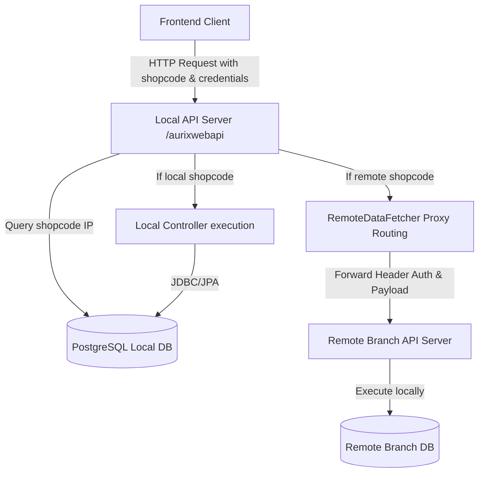
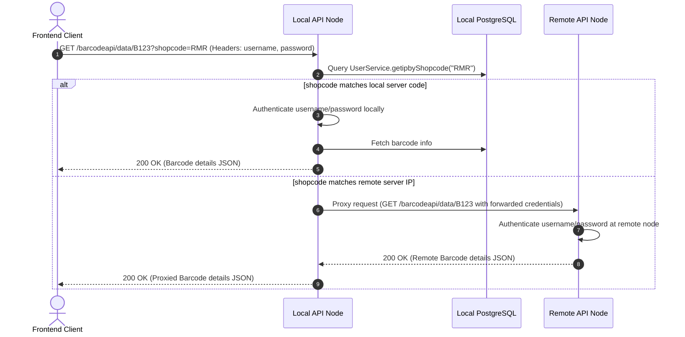
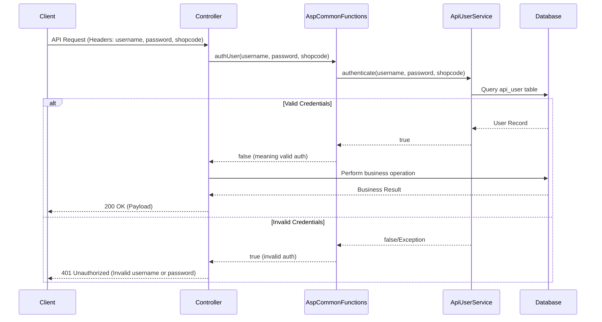
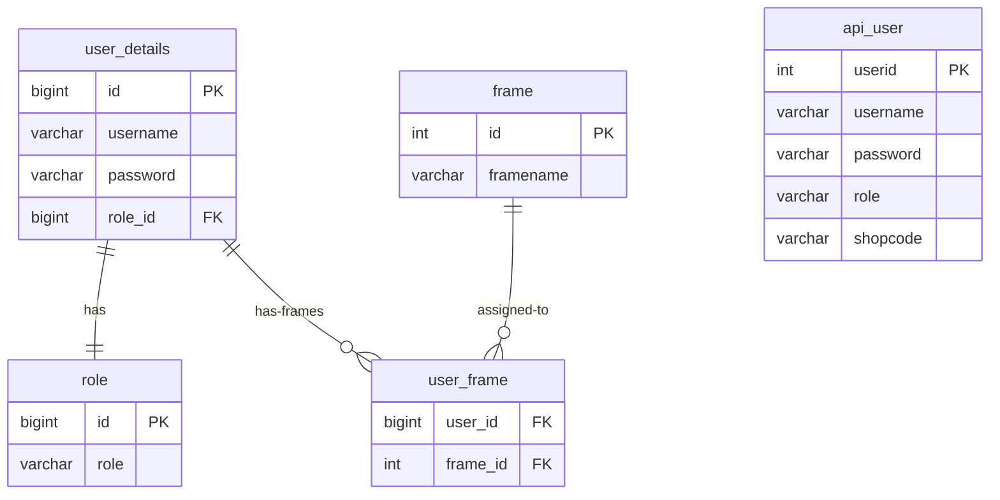
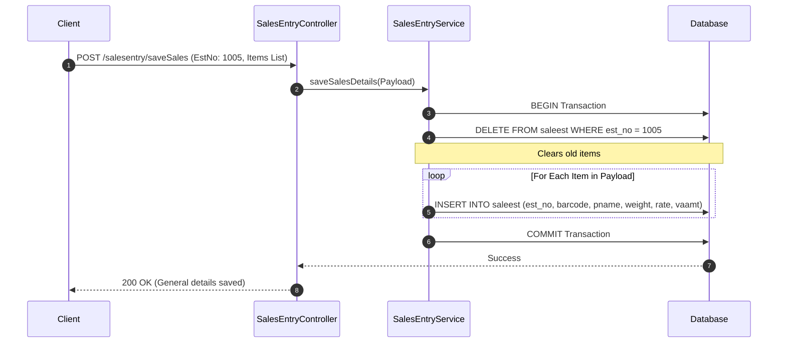

# 🏛️ Aurix Web API - Enterprise Architecture & API Documentation

---

## 1. Cover Page

**Project Name:** Aurix Web API  
**System Type:** Multi-Tenant Inter-Branch Jewelry Billing Backend  
**Document Version:** 1.0 (Enterprise Release)  
**Company:** Blogtec Software LLP  
**Website:** [https://www.blogtec.co.in/](https://www.blogtec.co.in/)  
**Support Email:** [blogtecsoftware@gmail.com](mailto:blogtecsoftware@gmail.com)  
**Target Audience:** Engineers, QA Teams, DevOps, System Architects, API Consumers  
**Prepared By:** Senior Java Software Architect & Technical Writer, Blogtec Software LLP  
**Date:** June 30, 2026  
**Copyright:** © 2026 Blogtec Software LLP. All rights reserved. Confidential.

---

## 2. Table of Contents

1. [Cover Page](#1-cover-page)
2. [Table of Contents](#2-table-of-contents)
3. [Project Overview](#3-project-overview)
4. [System Architecture](#4-system-architecture)
5. [Technology Stack](#5-technology-stack)
6. [Project Structure](#6-project-structure)
7. [API Overview](#7-api-overview)
8. [API Documentation](#8-api-documentation)
9. [Authentication](#9-authentication)
10. [Database Documentation](#10-database-documentation)
11. [Validation Rules](#11-validation-rules)
12. [Exception Handling](#12-exception-handling)
13. [Response Format](#13-response-format)
14. [API Flow](#14-api-flow)
15. [Security Documentation](#15-security-documentation)
16. [Configuration](#16-configuration)
17. [Build and Run](#17-build-and-run)
18. [Deployment Guide](#18-deployment-guide)
19. [API Testing](#19-api-testing)
20. [Best Practices](#20-best-practices)
21. [Troubleshooting](#21-troubleshooting)
22. [FAQ](#22-faq)
23. [Appendix](#23-appendix)

---

## 3. Project Overview

### Purpose
The Aurix Web API is a secure, high-performance Spring Boot backend engineered to serve as a bridge between modern web/mobile user interfaces and legacy desktop jewelry billing databases. It enables multi-branch operations, real-time inventory checks, and transactional sales operations across distributed shop systems.

### Business Objective
- **Legacy Parity:** Maintain 100% functional parity with pre-existing desktop jewelry billing engines.
- **Inter-Branch Proxy Routing:** Enable users at any branch to query stock, salesman details, and estimate records from any other branch seamlessly.
- **Data Integrity:** Guarantee transactional safety during estimates deletion and billing modification.
- **Modern Access:** Expose REST endpoints to allow mobile apps (e.g., Aurix Owners App) and web clients to query branch analytics.

### Key Features
1. **Inter-Branch Routing Engine:** Automatic proxy routing of API calls to remote shop database nodes using dynamic shop-code discovery.
2. **Modular Sales & Billing Engine:** Granular billing saves (`saveGeneral`, `saveSales`, `saveSman`, `saveStone`).
3. **Delete-then-Insert Strategy:** For estimate items updates, ensuring zero orphaned rows.
4. **CRM Integration:** Customer profile lookup, registration, and legacy customer identification.
5. **Customer Lounge Browser:** Digital gallery featuring design categories, design files, detailed specs, and barcodes.
6. **Real-time Product Imaging:** On-the-fly streaming of barcode product photos.
7. **Post-Billing Cashmarking & Discounts:** Value-Addition (VA) adjustment, stone rates update, and final manager approval discount tags.

### Target Users
- **Sales Executives:** Browsing items on tablets inside the showroom lounge.
- **Billing Managers:** Billed estimates tracking, discounts validation.
- **Shop Owners:** Remote real-time shop analytics and status updates via mobile application.
- **DevOps & QA Teams:** System deployment and testing.

---

## 4. System Architecture

The Aurix system operates as an **Inter-Branch Distributed Routing Cluster**. If a client requests data with a `shopcode` belonging to another branch, the local API serves as a Reverse Proxy, forwarding the request to the target branch server's public IP.



### Routing Logic Sequence



---

## 5. Technology Stack

* **Java 17 (LTS):** Utilizing modern record structures, switch expressions, and strong typing.
* **Spring Boot 3.5.13:** The framework base providing modern Jakarta EE configurations, auto-config, and embedded Tomcat.
* **Spring MVC:** REST controllers mapping and path handling.
* **Spring Security:** Standardized endpoint routing rules and CORS policy. Stateless HTTP session policy ensures tokenless, header-based auth per request.
* **Spring Data JPA / Hibernate:** Object-Relational Mapping (ORM) used for clean metadata models (e.g., `UserDetails`, `ApiUser`, `Role`, `Frameentity`).
* **PostgreSQL:** Scalable database store containing billing details, inventory tracking (`mainstock`), and client registration rules.
* **Maven:** Dependency lifecycle and build management.
* **Springdoc-openapi/Swagger (v2.2.0):** Autogenerated UI spec for developer sandbox testing.
* **JWT (Optional preparation):** Placeholder support for custom claims formatting.
* **Lombok:** Boilerplate reduction (`@Getter`, `@Setter`, `@NoArgsConstructor`, `@AllArgsConstructor`, `@Data`).
* **Jackson:** High-speed JSON serialization and deserialization.

---

## 6. Project Structure

```
com.blogtec.aurixwebapi
├── AurixwebapiApplication.java (Main Entry Bootstrapper)
├── ServletInitializer.java (WAR Packaging Initializer)
│
├── apiuser (Client User Identities for API Access)
│   ├── ApiUser.java (Entity)
│   ├── ApiUserController.java (Controller)
│   ├── ApiUserRepository.java (Repository)
│   ├── ApiUserResponse.java (DTO)
│   └── ApiUserService.java / ApiUserServiceImpl.java (Service)
│
├── asp.lib (AspCommonFunctions Helper Classes)
│   └── AspCommonFunctions.java (Timezones, auth checks, null checkers)
│
├── Barcode (Inventory Barcode Specs)
│   ├── BarcodeDetails.java (Entity)
│   └── BarcodeDetailsController.java / Service / Repository
│
├── careoff (Care-Of Reference Codes)
│   └── CareOfController.java / Service / Repository / DTOs
│
├── company (Shop Identity & Info Settings)
│   └── CompanyController.java / Service / Repository / Entity
│
├── config (System Environment Beans)
│   ├── DataInitializer.java (Pre-seeding default roles/users)
│   ├── DynamicDBConnection.java (Dynamic database profiles selector)
│   ├── InMemoryCacheConfig.java (Cache details configuration)
│   ├── IpConfig.java (IP mapping settings)
│   ├── RestTemplateConfig.java (HttpClient proxy bean)
│   ├── SecurityConfig.java (Spring Security filters & CORS)
│   ├── ServerInfo.java / ServerPortConfig.java
│   └── db (Multi-Tenant Datasource configurations)
│
├── configuration (Global Exceptions and DTO mappings)
│   ├── ErrorDetails.java
│   ├── GlobalExceptionHandler.java
│   └── ResourceNotFoundException.java / RemoteBranchException.java
│
├── customer (CRM customer profiles)
│   └── CustomerDataController.java / Service / Repository
│
├── customerlounge (Lounge Catalog Browsing)
│   └── CustomerLoungeController.java / Service / Repository / DTOs
│
├── discountdetails (Manager Billed Discounts tracker)
│   └── DiscountDetailsController.java / Service / Repository / Entity
│
├── dto (Global DTOs)
│   └── EasyTotalDto.java, SalesmanMasterDto.java, StoneMasterDto.java, etc.
│
├── dynamic (Dynamic SQL queries execution engine)
│   └── DynamicQueryController.java / Service / Request DTO
│
├── easytotal (Dashboard daily summary cards)
│   └── EasyTotalController.java / Service
│
├── imagesstorage (File System Image storage services)
│   └── ImageController.java / Service
│
├── payload (Structured billing payloads)
│   └── SalesGeneralPayload.java, SalesItemsPayload.java, SalesSmanPayload.java, etc.
│
├── role (Security Roles Entity)
│   └── Role.java / RoleRepository.java
│
├── sales (Modular Billing Engine & Cashmarking)
│   ├── CashMarkingController.java / Service / Repositories
│   ├── SalesEntryController.java / Service
│   ├── SalesPrintController.java / Service
│   ├── SalesDeleteController.java / Service
│   ├── salescheckingcontroller.java / Service
│   └── SalesBarcodeController.java / Service
│
├── salesmanmaster (Showroom sales staff profiles)
│   └── SalesmanMasterController.java / Service
│
└── utils (Reverse Proxy Helper Engine)
    └── RemoteDataFetcher.java (Proxied HTTP client dispatcher)
```

---

## 7. API Overview

| Method | Endpoint | Description | Authentication |
| :--- | :--- | :--- | :--- |
| **POST** | `/user/login` | User login (returns role & layout frames). | Public |
| **POST** | `/user/register` | Register showroom staff member. | Public |
| **POST** | `/apiuser/create` | Create API consumer credentials. | Public |
| **GET** | `/apiuser/find-by-id/{id}`| Fetch API consumer details. | Header Auth |
| **POST** | `/salesentry/saveGeneral`| Save estimate invoice header. | Header Auth |
| **POST** | `/salesentry/saveSales` | Save estimate item list. | Header Auth |
| **POST** | `/salesentry/saveSman` | Save salesman assignments to bill. | Header Auth |
| **POST** | `/salesentry/saveStone` | Save stone weights and rates. | Header Auth |
| **GET** | `/saleschecking/estenochecking/{goldSlv}`| Get distinct estimate numbers list by metal. | Header Auth |
| **DELETE**| `/salesdelete/delete/{estNo}`| Permanently delete estimate invoices. | Header Auth |
| **GET** | `/barcodeapi/data/{barcode}`| Get stock item weights, rates, description. | Header Auth |
| **GET** | `/barcodeapi/getImagebyBarcode/{barcode}`| Fetch product image by barcode. | Header Auth |
| **GET** | `/customer/crmphoneno/{phone}`| Look up CRM profile by phone. | Public |
| **POST** | `/customer/create` | Create CRM profile. | Header Auth |
| **GET** | `/customerlounge/getCategoryForCustomer`| Lounge category list. | Public |
| **GET** | `/customerlounge/getDetailedBarcodeData`| Detailed design specs for customer. | Header Auth |
| **GET** | `/cashmark/getcheckestno/{id}`| Check if estimate is cashmarked. | Header Auth |
| **POST** | `/cashmark/updatevadata`| Update Value-Addition (VA) data. | Header Auth |
| **GET** | `/easytotal/geteasytotal` | Dashboard aggregated cards data. | Header Auth |
| **POST** | `/api/query/execute` | Execute dynamic SQL payload. | Header Auth |

---

## 8. API Documentation

### 8.1. User Login
* **Purpose:** Authenticate staff username/password.
* **HTTP Method:** `POST`
* **URL:** `/user/login`
* **Authentication Required:** No (Public)
* **Headers:** `Content-Type: application/json`
* **Request Body:**
  ```json
  {
    "username": "BLOGTEC",
    "password": "123"
  }
  ```
* **Validation Rules:** Username and Password cannot be empty.
* **Business Logic:** Matches password using `BCryptPasswordEncoder` against `user_details` db table. Returns authorized application screens (frames) and roles.
* **Response (HTTP Status 200):**
  ```json
  {
    "username": "BLOGTEC",
    "roles": ["ADMIN"],
    "frames": [
      { "id": 1, "framename": "frmSales" },
      { "id": 2, "framename": "frmCRM" }
    ]
  }
  ```
* **Error Response (HTTP Status 401):**
  ```json
  "Invalid username or password"
  ```
* **Curl Example:**
  ```bash
  curl -X POST http://localhost:8080/aurixwebapi/user/login \
    -H "Content-Type: application/json" \
    -d '{"username":"BLOGTEC","password":"123"}'
  ```

---

### 8.2. Save General Estimate Header
* **Purpose:** Save estimate header information.
* **HTTP Method:** `POST`
* **URL:** `/salesentry/saveGeneral`
* **Authentication Required:** Yes
* **Headers:**
  * `username`: (API user)
  * `password`: (API password)
  * `Content-Type`: `application/json`
* **Query Parameters:** `shopcode=TCR`
* **Request Body:**
  ```json
  {
    "estNo": 1005,
    "estDte": "2026-06-30",
    "estGrate": 6850.00,
    "userid": 1,
    "custid": "CUST100",
    "estCunm": "Hari Kumar",
    "goldSlv": "G",
    "estTamt": 125000.00,
    "gstno": "32AAAAA0000A1Z1",
    "shopcode": "TCR"
  }
  ```
* **Business Logic:** Saves estimate details to the `estmstr` metadata table. If `shopcode` is not the local shop code, routes the request to the target branch server.
* **Response (HTTP Status 200):**
  ```json
  {
    "status": "success",
    "message": "General details saved"
  }
  ```
* **Curl Example:**
  ```bash
  curl -X POST "http://localhost:8080/aurixwebapi/salesentry/saveGeneral?shopcode=TCR" \
    -H "username: api_user" \
    -H "password: password123" \
    -H "Content-Type: application/json" \
    -d '{"estNo":1005,"estDte":"2026-06-30","estGrate":6850.00,"custid":"CUST100","estCunm":"Hari Kumar","goldSlv":"G","estTamt":125000.00}'
  ```

---

### 8.3. Get Barcode Stock Specifications
* **Purpose:** Look up jewelry specifications by scanning/typing barcode.
* **HTTP Method:** `GET`
* **URL:** `/barcodeapi/data/{barcode}`
* **Authentication Required:** Yes
* **Headers:**
  * `username`: (API user)
  * `password`: (API password)
* **Query Parameters:** `shopcode=TCR`
* **Path Variables:** `barcode` (String)
* **Response (HTTP Status 200):**
  ```json
  {
    "barcodeDetails": [
      {
        "barcode": "B01124",
        "pname": "916 Gold Bangle",
        "netwt": 12.350,
        "grosswt": 12.450,
        "vaamt": 150.00
      }
    ]
  }
  ```
* **Curl Example:**
  ```bash
  curl -X GET "http://localhost:8080/aurixwebapi/barcodeapi/data/B01124?shopcode=TCR" \
    -H "username: api_user" \
    -H "password: password123"
  ```

---

## 9. Authentication

Rather than standard stateless OAuth tokens or session cookies, this project utilizes **Header-Based Database Credentials Authorization** for secured endpoints:

1. Secure requests include custom headers: `username` and `password`.
2. Secured controllers intercept these headers and validate them against the `apiuser` table using `AspCommonFunctions.authUser(username, password, shopcode, apiUserService)`.
3. Inter-branch requests are proxied via `RemoteDataFetcher`, which copies these authorization headers to ensure credential consistency across branches.

### Security Handshake Flow



---

## 10. Database Documentation

Below is the entity schema mapping for the system.

### Table: `user_details`
* **Primary Key:** `id` (serial/bigint)
* **Columns:**
  * `username` (varchar) - Unique login username.
  * `password` (varchar) - BCrypt encrypted password.
  * `role_id` (bigint) - Foreign key referencing `role.id`.

### Table: `role`
* **Primary Key:** `id` (serial/bigint)
* **Columns:**
  * `role` (varchar) - Role name (e.g., ADMIN, SALESMAN).

### Table: `user_frame` (Join Table)
* **Columns:**
  * `user_id` (bigint) - References `user_details.id`.
  * `frame_id` (int) - References `frame.id`.

### Table: `frame`
* **Primary Key:** `id` (serial/int)
* **Columns:**
  * `framename` (varchar) - Screen identifiers mapped to UI layouts.

### Table: `api_user`
* **Primary Key:** `userid` (serial/int)
* **Columns:**
  * `username` (varchar)
  * `password` (varchar)
  * `role` (varchar)
  * `shopcode` (varchar) - Branch code.

### Database ER Diagram



---

## 11. Validation Rules

* **Null-Safety Bridge:** Implemented through `AspCommonFunctions.checkNull()`. It automatically translates Java `null` variables into fallback default parameters (`""` for String, `0` for numeric fields, `BigDecimal.ZERO` for prices).
* **System user registration validations:** Handled during registration inside `UserServiceImp.java`.
* **Dynamic Query validations:** The dynamic query engine checks SQL statements against a blacklist of unauthorized modification commands (`UPDATE`, `DELETE`, `TRUNCATE`, `DROP`) to prevent SQL Injection risks.

---

## 12. Exception Handling

The system defines a unified response model for exceptions through `GlobalExceptionHandler.java` and `ErrorDetails.java`.

### Error Detail Schema
```json
{
  "timestamp": "2026-06-30T12:30:00.000+00:00",
  "message": "Error details description",
  "details": "uri=/aurixwebapi/some-endpoint"
}
```

### Standard Exceptions Mapping
* **`ResourceNotFoundException`:** Returns `404 Not Found`.
* **`RemoteBranchException`:** Triggered when proxying to another branch fails. Returns `502 Bad Gateway` or the status returned by the remote node.
* **`MissingServletRequestParameterException` / `MissingRequestHeaderException`:** Returns `400 Bad Request` outlining the missing key.
* **`IllegalArgumentException`:** Returns `400 Bad Request`.
* **`Exception.class`:** Fallback returning `500 Internal Server Error`.

---

## 13. Response Format

### Successful Responses
Successful responses return standard JSON models (DTOs) or basic status maps:
```json
{
  "status": "success",
  "message": "Operation completed successfully"
}
```

### Error Responses
Error responses follow the standard `ErrorDetails` structure:
```json
{
  "timestamp": "2026-06-30T12:35:12.345Z",
  "message": "Resource not found",
  "details": "uri=/aurixwebapi/customer/getCustData/C999"
}
```

---

## 14. API Flow

### Workflows: "Delete-Then-Insert" Sales Entry Pattern
To prevent orphan rows in billing database tables, update queries are not used for estimate item updates. Instead, the application deletes all items associated with the estimate number first, then inserts the fresh collection.



---

## 15. Security Documentation

### Spring Security Filter Chain
Defined in `com.blogtec.aurixwebapi.config.SecurityConfig`.
1. **CSRF:** Disabled (`csrf.disable()`) as it is a stateless API.
2. **CORS:** Configuration source dynamically permits requests originating from `localhost:3000`, `localhost:3001`, `localhost:5173`, `localhost:9090` and the host system IPs.
3. **Authorization Filters:** All API paths are set to `.permitAll()` in Spring Security, as authentication checks are handled by the controller logic calling `AspCommonFunctions.authUser`.

---

## 16. Configuration

### key properties in `application.properties`
* **`server.servlet.context-path`:** `/aurixwebapi`
* **`spring.datasource.url`:** `jdbc:postgresql://localhost:5432/kjbillsoft`
* **`spring.datasource.username`:** Database user (default: `postgres`)
* **`spring.datasource.password`:** Database password.
* **`spring.jpa.hibernate.ddl-auto`:** `create` (Initial setup. Switch to `none` or `validate` in production).
* **`spring.servlet.multipart.max-file-size`:** `20MB` (Permitted file size for lounge item images upload).

---

## 17. Build and Run

### 1. Build Package
Open terminal in the project directory:
```powershell
mvn clean package
```
This generates the war package `target/aurixwebapi.war`.

### 2. Running local dev server
To run locally:
```powershell
mvn spring-boot:run
```
The server starts on port `8080`.

### 3. Verification URLs
* **Swagger Documentation:** `http://localhost:8080/aurixwebapi/swagger-ui/index.html`
* **Default Login Check:** `http://localhost:8080/aurixwebapi/user/login`

---

## 18. Deployment Guide

### Linux/Windows Server Deployment
1. Build the production WAR file: `mvn clean package`.
2. Copy the generated `aurixwebapi.war` from the `target` folder.
3. Deploy to Tomcat's webapps directory: `/opt/tomcat/webapps/` or `C:\Program Files\Apache Software Foundation\Tomcat 10.0\webapps\`.
4. Setup postgres database connections and verify networking ports are open.

---

## 19. API Testing

### 19.1. Swagger / OpenAPI Interactive UI Testing
The Aurix Web API integrates `springdoc-openapi-starter-webmvc-ui` to auto-generate interactive API specifications.

- **OpenAPI JSON Spec URL:** `http://localhost:8080/aurixwebapi/v3/api-docs`
- **Swagger Interactive UI URL:** `http://localhost:8080/aurixwebapi/swagger-ui/index.html`

#### Testing Secured Endpoints via Swagger UI:
1. Open the Swagger UI URL in your web browser.
2. Select the endpoint you wish to test (e.g., `/salesentry/saveGeneral`).
3. Click **Try it out**.
4. In the Request Headers fields, enter the authentication parameters:
   - `username`: Enter the API consumer username (registered in `apiuser` table).
   - `password`: Enter the API consumer password.
5. Provide the required parameters (e.g., `shopcode`) and request body if applicable.
6. Click **Execute** to view the response code and JSON payload.

### 19.2. Verification with Curl
To verify that the API is running correctly via command line, execute:
```bash
curl -X GET "http://localhost:8080/aurixwebapi/customer/getipadrress"
```
Response:
```json
{
  "Baseurl": "http://localhost:8080/aurixwebapi"
}
```

---

## 20. Best Practices

* **Transaction Scope:** Critical billing actions are annotated with `@Transactional` to avoid partial data writes on failure.
* **Timezone Consistency:** Use `AspCommonFunctions.getISTTime()` instead of standard system time to ensure India-standard billing consistency.
* **Stateless Design:** Avoid HTTP Session state storage to keep backend instances horizontally scalable.

---

## 21. Troubleshooting

### 1. Remote Branch Connection Timeout
* **Reason:** Target branch server is offline or firewall blocks port 8080.
* **Solution:** Verify that target branch IP is reachable and verify port permissions.

### 2. Invalid Username or Password
* **Reason:** Missing or invalid `username` / `password` headers.
* **Solution:** Verify API client credentials in `apiuser` database.

---

## 22. FAQ

* **Q: How does inter-branch routing work?**  
  A: If the client requests data for a different branch (`shopcode`), the local branch forwards the request to that branch's server IP via HTTP client and returns the response.
* **Q: Why delete-then-insert?**  
  A: This ensures that if items in an estimate are removed during updates, they are not left behind as orphaned rows.

---

## 23. Appendix

* **GST:** Goods and Services Tax (India).
* **VA:** Value Addition (Charge on making charges/wastage in jewelry).
* **ESTMSTR:** Estimate Master (Header billing table).
* **SALEEST:** Sale Estimate (Itemized details table).
