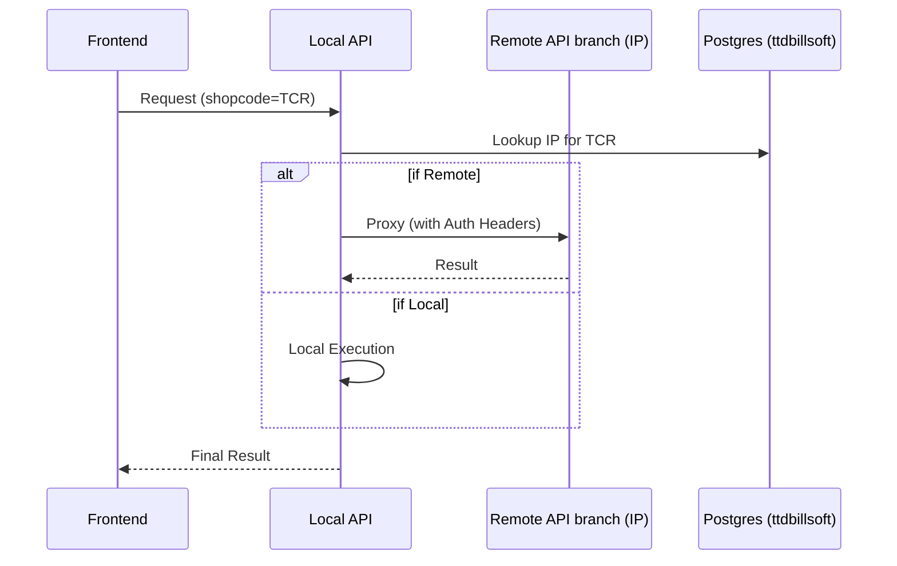

# 🏛️ Aurix Web API - Developer Master Wiki

This guide is designed for engineering onboarding. It explains the core concepts, architectural patterns, and "under-the-hood" logic of the Aurix system.

---

## 🚀 1. Engineering Core
The Aurix Web API is a modernized Spring Boot backend that maintains strict functional parity with legacy jewelry billing systems.

| Component | Technology | Rationale |
| :--- | :--- | :--- |
| **Framework** | Spring Boot 3.5.13 | Modern Jakarta EE support & integrated security. |
| **Language** | Java 17 | Core LTS version for record support and sealed classes. |
| **Data Layer** | JDBC Template / JPA | Hybrid approach: JPA for simple CRUD, JDBC for high-performance billing. |
| **Database** | PostgreSQL | Enterprise-grade sharding support via multi-tenant IP routing. |

---

## 🔀 2. The Proxy Routing Engine
The most critical concept in Aurix is **Inter-Branch Proxying** managed by the `RemoteDataFetcher`.

### The Routing Logic
Every incoming request includes a `shopcode`. The system uses a **"Route First, Auth Second"** pattern:
1. **IP Discovery**: `UserService.getipbyShopcode(shopcode)` fetches the target branch's server IP from the database.
2. **Local vs Remote**:
   - If `shopcode` matches the local server, execution continues locally.
   - If not, `RemoteDataFetcher` intercepts the request and proxies it to the remote IP.
3. **Header Forwarding**: Security headers (`username`, `password`) are automatically injected into the proxied request to ensure auth persistence across branches.

---

## 🛡️ 3. Security & Business Logic Bridge
The application bridges modern REST controllers with specialized business rules via the `com.blogtec.aurixwebapi.asp.lib` package.

### Security Bridge (`AspCommonFunctions.authUser`)
The system does not use standard Bearer tokens. Instead, it uses custom headers validated per-request:
- **`username`/`password` Headers**: Checked against the `apiuser` table.
- **Cross-Branch Sessions**: The `RemoteDataFetcher` ensures that credentials passed to one branch are valid when proxied to another.

### Business Logic Parity
- **IST Timezone**: Standardized via `AspCommonFunctions.getISTTime()` for consistent billing timestamps.
- **Financial Year Tracking**: Logic to automatically handle India-specific financial calendars (April–March).

---

## 💾 4. Persistence Patterns
To ensure 100% data integrity and mirror legacy desktop behavior, the application uses a **Modular Consistency Strategy**.

### The "Delete-then-Insert" Requirement
For complex entities like **Sales Entry (Estimates)**, we do not use `UPDATE` statements. Instead:
1. Every save request triggers a targeted `DELETE` for the specific `estNo`.
2. This is immediately followed by a clean `INSERT` of the new payload.
3. This prevents "orphaned" items or stones when the number of lines in a bill changes.

### Transaction Management
All modular endpoints (`saveGeneral`, `saveSales`, etc.) are annotated with `@Transactional` to ensure that if a modular insert fails, the previous delete is rolled back.

---

## 🗂️ 5. Domain Directory
| Domain | Responsibility | Design Concept |
| :--- | :--- | :--- |
| **Sales** | Billing & Lifecycle | Multi-step modular sequence. |
| **Customer** | CRM & Lounge | Phone-based sharded lookup. |
| **Inventory** | Barcodes & Imaging | Real-time byte[] image streaming. |
| **Masters** | Staff & Company | Shop-code restricted lookup. |

---

## 📚 Reference Library
- 📖 **[Master API Guide](file:///d:/Software/SpringbootBackendWorkSpace/aurixwebapi/MASTER_API_GUIDE.md)**: Full endpoint specifications.
- 📖 **[Full Architecture Guide](file:///d:/Software/SpringbootBackendWorkSpace/aurixwebapi/FULL_SYSTEM_INTEGRATION_GUIDE.md)**: Detailed package functions.
- 📖 **[Sales Module Manual](file:///d:/Software/SpringbootBackendWorkSpace/aurixwebapi/SALES_MODULE_DOCUMENTATION.md)**: Logic for the billing engine.
